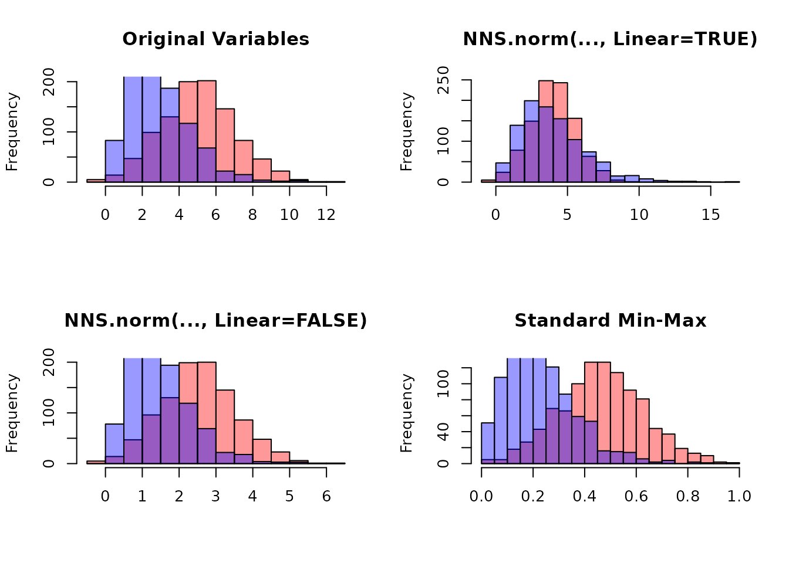

# Getting Started with NNS: Normalization and Rescaling

``` r

library(NNS)
require(knitr)
require(rgl)
```

### Overview

This vignette covers two related tools:

- [`NNS.norm()`](https://OVVO-Financial.github.io/NNS/reference/NNS.norm.md)
  for cross‑variable normalization when comparing multiple series.
- [`NNS.rescale()`](https://OVVO-Financial.github.io/NNS/reference/NNS.rescale.md)
  for single‑vector rescaling with either min‑max or risk‑neutral
  targets.

Both functions are deterministic rescalings.
[`NNS.rescale()`](https://OVVO-Financial.github.io/NNS/reference/NNS.rescale.md)
is affine on a single vector and preserves its rank structure.
[`NNS.norm()`](https://OVVO-Financial.github.io/NNS/reference/NNS.norm.md)
multiplies each column by its own factor, so it preserves the order
within each column, but in nonlinear mode a factor can be negative,
which reverses that column’s order and the sign of its correlations with
the others (see the note below).

------------------------------------------------------------------------

## `NNS.norm()`: Normalize Multiple Variables

[`NNS.norm()`](https://OVVO-Financial.github.io/NNS/reference/NNS.norm.md)
rescales variables to a common magnitude while preserving distributional
structure. The method can be **linear** (all variables forced to have
the same mean) or **nonlinear** (using dependence weights to produce a
more nuanced scaling). In the nonlinear case, the degree of association
between variables influences the final normalized values.

### Mathematical Structure

Let $`X`$ be an $`n \times p`$ matrix of variables.

#### Step 1: Compute Mean Vector

``` math
m_j = \text{mean}(X_{\cdot j})
```

If any $`m_j = 0`$, it is replaced with $`10^{-10}`$ to prevent division
by zero.

------------------------------------------------------------------------

#### Step 2: Construct Mean Ratio Matrix

``` math
RG_{ij} = \frac{m_i}{m_j}
```

In R this corresponds to:

``` r

RG <- outer(m, 1 / m)
```

------------------------------------------------------------------------

#### Step 3: Dependence Weight Matrix

If `linear = FALSE`:

- If number of variables $`p < 10`$:
  ``` math
  W = |\mathrm{cor}(X)|
  ```
- Otherwise:
  ``` math
  W = |D| \quad \text{where } D = \text{NNS.dep}(X)\$Dependence
  ```
  [`NNS.dep()`](https://OVVO-Financial.github.io/NNS/reference/NNS.dep.md)
  returns a symmetric matrix of nonlinear dependence measures.

If `linear = TRUE`, the weighting effectively becomes:

``` math
W_{ij} = 1
```

------------------------------------------------------------------------

#### Step 4: Scaling Factors

``` math
s_j = \frac{1}{p} \sum_{i=1}^{p} RG_{ij} W_{ij}
```

Each column is scaled:

``` math
X_{\cdot j}^{*} = s_j X_{\cdot j}
```

------------------------------------------------------------------------

### Linear Case Proof

If $`W_{ij} = 1`$:

``` math
s_j = \frac{1}{p} \sum_{i=1}^{p} \frac{m_i}{m_j}
= \frac{\bar{m}}{m_j}
```

Then:

``` math
\text{mean}(X_{\cdot j}^{*}) = s_j m_j = \bar{m}
```

All variables share the same mean.

------------------------------------------------------------------------

### Nonlinear Case Interpretation

``` math
\text{mean}(X_{\cdot j}^{*})
=
\frac{1}{p}
\sum_{i=1}^{p}
m_i W_{ij}
```

Thus, the normalized mean becomes a dependence‑weighted average of
original means. Variables more strongly dependent with higher‑mean
variables scale upward more.

------------------------------------------------------------------------

### Examples

#### Basic Multivariate Example

This holds for any distribution type and can be applied to vectors of
different lengths. Each column is multiplied by a factor built from
ratios of column means, so the columns should have positive means. A
mean near zero, or of the opposite sign to the others, gives a very
large or negative factor (see the note at the end of this vignette); the
columns below are all positive.

``` r
set.seed(123)

A <- rnorm(100, mean = 5, sd = 1)
B <- rnorm(100, mean = 20, sd = 5)
C <- rnorm(100, mean = 10, sd = 1)
D <- rnorm(100, mean = 50, sd = 10)

X <- data.frame(A, B, C, D)

# Linear scaling
lin_norm <- NNS.norm(X, linear = TRUE, chart.type = NULL)
head(lin_norm)
     A Normalized B Normalized C Normalized D Normalized
[1,]     18.38264     17.81323     25.40626     18.19440
[2,]     19.75029     23.05113     23.56018     18.03539
[3,]     27.15749     20.32425     20.27462     17.24622
[4,]     20.99534     19.77814     21.95814     16.76224
[5,]     21.23872     16.50706     19.96390     19.37523
[6,]     27.80492     21.41627     19.83496     22.63783

# Verify means are equal
apply(lin_norm, 2, function(x) c(mean = mean(x), sd = sd(x)))

     A Normalized B Normalized C Normalized D Normalized
mean    21.077727    21.077727    21.077727    21.077727
sd       3.779676     5.236256     1.978297     4.410985
```

Each column keeps its coefficient of variation and its correlations with
the others, because it is multiplied by a single positive factor.

Now compare with **nonlinear scaling**:

``` r
nonlin_norm <- NNS.norm(X, linear = FALSE, chart.type = NULL)
head(nonlin_norm)
     A Normalized B Normalized C Normalized D Normalized
[1,]     2.082162     4.690344     4.098285     11.04240
[2,]     2.237074     6.069519     3.800493     10.94589
[3,]     3.076072     5.351514     3.270500     10.46693
[4,]     2.378098     5.207720     3.542068     10.17321
[5,]     2.405665     4.346421     3.220377     11.75906
[6,]     3.149404     5.639050     3.199579     13.73917

apply(nonlin_norm, 2, function(x) c(mean = mean(x), sd = sd(x)))

     A Normalized B Normalized C Normalized D Normalized
mean    2.3874296     5.549909    3.4000486     12.79232
sd      0.4281159     1.378742    0.3191192      2.67708
```

Note that the means differ and the standard deviations are smaller than
in the linear case, reflecting the dependence structure.

##### Normalize list of unequal vector lengths

``` r
set.seed(123)
vec1 <- rnorm(n = 10, mean = 0, sd = 1)
vec2 <- rnorm(n = 5, mean = 5, sd = 5)
vec3 <- rnorm(n = 8, mean = 10, sd = 10)

vec_list <- list(vec1, vec2, vec3)

NNS.norm(vec_list)

$`x_1 Normalized`
 [1]  13.074058  -3.004912 -11.745878  25.406891  -4.647966  -5.481229   6.225165   5.920719   6.113733   9.640242

$`x_2 Normalized`
[1]  2.875960212  0.008876158  1.230826150  5.855582361 10.779166523

$`x_3 Normalized`
[1]  4.0749062  2.2395840  0.4067264  0.7457562 15.6445780  5.1941416  2.3326665  2.5622994
```

------------------------------------------------------------------------

#### Quantile Normalization Comparison

Quantile normalization forces distributions to be identical. This is
literally the opposite intended effect of `NNS.norm`, which preserves
individual distribution shapes while aligning ranges. The quantile
normalized series become identical in distribution, while the `NNS`
methods retain the original patterns.

------------------------------------------------------------------------

### Practical Applications

Normalization eliminates the need for multiple y‑axis charts and
prevents their misuse. By placing variables on the same axes with shared
ranges, we enable more relevant conditional probability analyses.
[`NNS.caus()`](https://OVVO-Financial.github.io/NNS/reference/NNS.caus.md)
places variables on a shared scale with per-column ranks instead, so its
results do not depend on the location or units of either variable.

------------------------------------------------------------------------

## `NNS.rescale()`: Distribution Rescaling

[`NNS.rescale()`](https://OVVO-Financial.github.io/NNS/reference/NNS.rescale.md)
performs one‑dimensional affine transformations.

Function signature:

    NNS.rescale(x, a, b, method = "minmax", T = NULL, type = "Terminal")

------------------------------------------------------------------------

### 1) Min-Max Scaling

If `method = "minmax"`:

``` math
x^{*}
=
a
+
(b - a)
\frac{x - \min(x)}
{\max(x) - \min(x)}
```

Properties:

- Preserves order
- Maps support to $`[a,b]`$
- Linear transformation

------------------------------------------------------------------------

#### Example

``` r

raw_vals <- c(-2.5, 0.2, 1.1, 3.7, 5.0)

scaled_minmax <- NNS.rescale(
  x = raw_vals,
  a = 5,
  b = 10,
  method = "minmax",
  T = NULL,
  type = "Terminal"
)

cbind(raw_vals, scaled_minmax)
#>      raw_vals scaled_minmax
#> [1,]     -2.5      5.000000
#> [2,]      0.2      6.800000
#> [3,]      1.1      7.400000
#> [4,]      3.7      9.133333
#> [5,]      5.0     10.000000
range(scaled_minmax)
#> [1]  5 10
```

------------------------------------------------------------------------

### 2) Risk-Neutral Scaling

If `method = "riskneutral"`:

Let:

- $`S_0 = a`$
- $`r = b`$
- $`T`$ = time horizon

#### Terminal Type

Target:

``` math
\mathbb{E}[S_T] = S_0 e^{rT}
```

Transformation form:

``` math
x^{*}
=
x
\cdot
\frac{S_0 e^{rT}}
{\text{mean}(x)}
```

This enforces the required expectation.

------------------------------------------------------------------------

#### Discounted Type

Target:

``` math
\mathbb{E}[e^{-rT} S_T] = S_0
```

Equivalent to:

``` math
\mathbb{E}[S_T] = S_0 e^{rT}
```

but the returned series is scaled so that its discounted mean equals
$`S_0`$. In practice, the function applies the same multiplicative
factor as above, because:

``` math
\text{mean}(e^{-rT} x^{*}) = e^{-rT} \cdot \text{mean}(x^{*}) = e^{-rT} \cdot S_0 e^{rT} = S_0.
```

------------------------------------------------------------------------

### Risk-Neutral Example

``` r
set.seed(123)
S0 <- 100
r <- 0.05
T <- 1

# Simulate a price path
prices <- S0 * exp(cumsum(rnorm(250, 0.0005, 0.02)))

rn_terminal <- NNS.rescale(
  x = prices,
  a = S0,
  b = r,
  method = "riskneutral",
  T = T,
  type = "Terminal"
)

c(
  mean_original = mean(prices),
  mean_rescaled = mean(rn_terminal),
  target = S0 * exp(r * T)
)

mean_original mean_rescaled        target 
     109.7019      105.1271      105.1271 
```

------------------------------------------------------------------------

### Discounted Example

``` r
rn_discounted <- NNS.rescale(
  x = prices,
  a = S0,
  b = r,
  method = "riskneutral",
  T = T,
  type = "Discounted"
)

c(
  mean_rescaled = mean(rn_discounted),
  target_discounted_mean = S0
)

         mean_rescaled target_discounted_mean 
                   100                    100 
```

------------------------------------------------------------------------

## Conceptual Summary

#### `NNS.norm()`

- Multivariate
- Dependence‑aware scaling
- Equalizes means only in linear mode
- One factor per column: shape is preserved, and order too unless the
  factor is negative

#### `NNS.rescale()`

- Univariate
- Affine transformation
- Either range‑targeted or expectation‑targeted
- Preserves rank structure

[`NNS.rescale()`](https://OVVO-Financial.github.io/NNS/reference/NNS.rescale.md)
is monotone increasing, so ranks, copulas and NNS dependence measures
are unchanged by it.
[`NNS.norm()`](https://OVVO-Financial.github.io/NNS/reference/NNS.norm.md)
is too when every factor is positive, but in either mode a column whose
mean has the opposite sign from the others gets a negative factor. For
example, with `x ~ N(1, 1)` and `y = x - 1.5 + noise`, `cor(x, y)` is
0.957 before
[`NNS.norm()`](https://OVVO-Financial.github.io/NNS/reference/NNS.norm.md)
and -0.957 after; with `x <- 1:4` and `y <- x - 4`, `linear = TRUE`
turns a correlation of 1 into -1 as well. Check the signs of the factors
before using normalized columns for dependence or causation.

``` r

set.seed(123)

x <- rnorm(1000, 5, 2)
y <- rgamma(1000, 3, 1)

# Combine variables
X <- cbind(x, y)

# NNS normalization
X_norm_lin <- NNS.norm(X, linear = TRUE)
X_norm_nonlin <- NNS.norm(X, linear = FALSE)

# Standard min-max normalization
minmax <- function(v) (v - min(v)) / (max(v) - min(v))
X_minmax <- apply(X, 2, minmax)
```



------------------------------------------------------------------------

## References

If the user is so motivated, detailed arguments further examples are
provided within the following:

- [Nonlinear Nonparametric Statistics: Using Partial
  Moments](https://ovvo-financial.github.io/NNS/book/)

- [Nonlinear Scaling Normalization with
  NNS](https://github.com/OVVO-Financial/NNS/blob/NNS-Beta-Version/examples/Normalization.pdf)
  (archived PDF; see the [current corrections and editable
  companion](https://github.com/OVVO-Financial/NNS/blob/NNS-Beta-Version/examples/example-corrections.md)
  for the normalization qualifications).

- [Distributional Equivalence in GBM: Outcome Transformation for
  Efficient Risk-Neutral Pricing](https://doi.org/10.2139/ssrn.5742907)
