# Getting Started with NNS: Clustering and Regression

``` r

library(NNS)
require(knitr)
```

## Clustering and Regression

Below are some examples demonstrating unsupervised learning with NNS
clustering and nonlinear regression using the resulting clusters. As
always, for a more thorough description and definition, please view the
References.

### NNS Partitioning `NNS.part()`

**`NNS.part`** is both a partitional and hierarchical clustering method.
`NNS` iteratively partitions the joint distribution into partial moment
quadrants, and then assigns a quadrant identification (1:4) at each
partition.

**`NNS.part`** returns a `data.frame` of observations along with their
final quadrant identification. It also returns regression points that
summarize observations within occupied cells. Their location follows the
chosen reduction rule; these points support the subsequent **`NNS.reg`**
fit.

``` r

x = seq(-5, 5, .05); y = x ^ 3

for(i in 1 : 4){NNS.part(x, y, order = i, Voronoi = TRUE, obs.req = 0)}
```

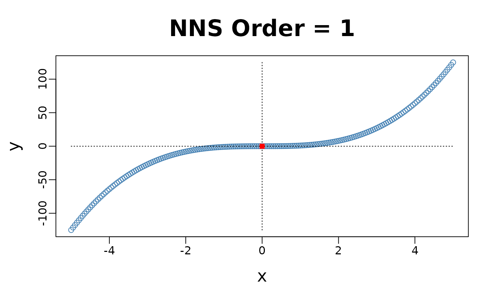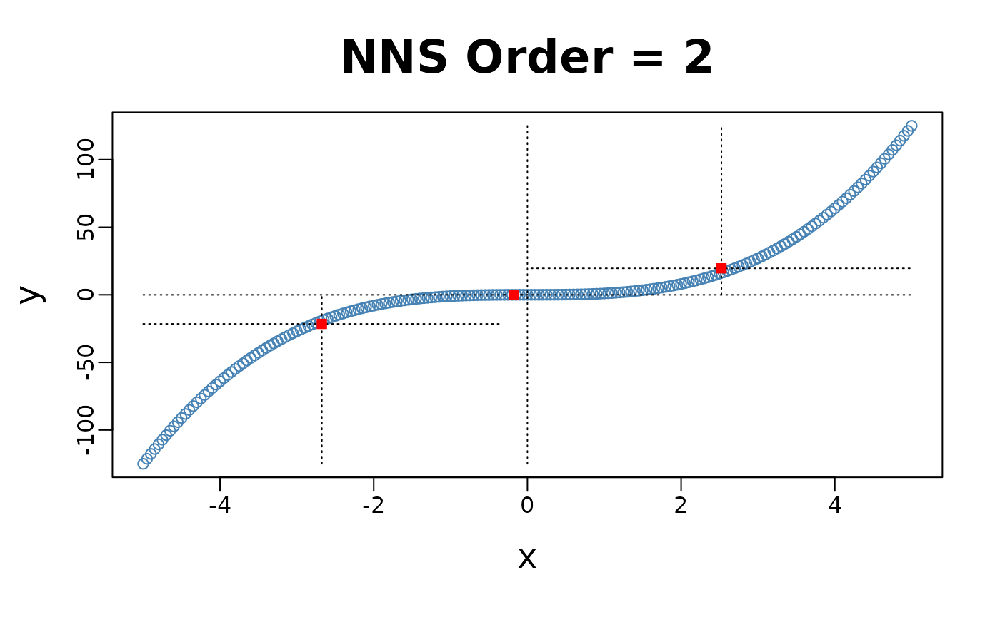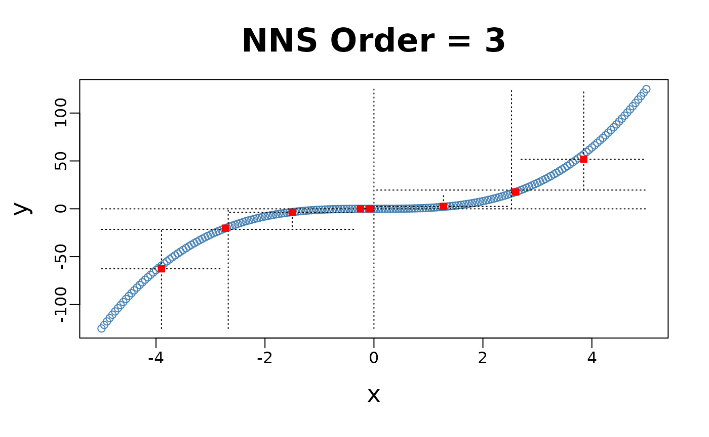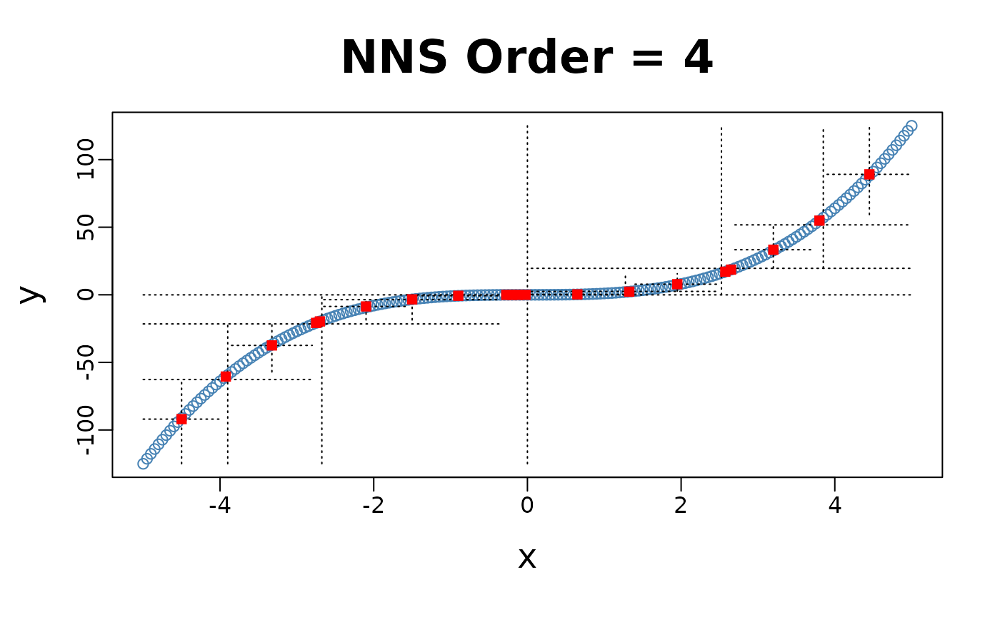

#### X-only Partitioning

**`NNS.part`** offers a partitioning based on $`x`$ values only
**`NNS.part(x, y, type = "XONLY", ...)`**, using the response
observations within each predictor cell to form regression points.
Consistency requires suitable shrinking cells and growing cell
occupancy; a fixed order or occupancy cutoff alone does not establish
those conditions.

``` r

for(i in 1 : 4){NNS.part(x, y, order = i, type = "XONLY", Voronoi = TRUE)}
```


Note the partition identifications are limited to 1’s and 2’s (left and
right of the partition respectively), not the 4 values per the $`x`$ and
$`y`$ partitioning.

    ## $order
    ## [1] 4
    ## 
    ## $dt
    ##       x         y quadrant prior.quadrant
    ## 1 -5.00 -125.0000    q1111           q111
    ## 2 -4.95 -121.2874    q1111           q111
    ## 3 -4.90 -117.6490    q1111           q111
    ## 4 -4.85 -114.0841    q1111           q111
    ## 5 -4.80 -110.5920    q1111           q111
    ## 6 -4.75 -107.1719    q1111           q111
    ## ---
    ##        x        y quadrant prior.quadrant
    ## 196 4.75 107.1719    q2222           q222
    ## 197 4.80 110.5920    q2222           q222
    ## 198 4.85 114.0841    q2222           q222
    ## 199 4.90 117.6490    q2222           q222
    ## 200 4.95 121.2874    q2222           q222
    ## 201 5.00 125.0000    q2222           q222
    ## --- [ 201 rows x 4 cols ]; showing first and last 6. Use as.data.frame(x) for all. ---
    ## 
    ## $regression.points
    ##   quadrant      x           y
    ## 1     q111 -4.375 -84.9871094
    ## 2     q112 -3.100 -30.6047500
    ## 3     q121 -1.850  -5.8342500
    ## 4     q122 -0.600  -0.2723437
    ## 5     q211  0.650   0.3331250
    ## 6     q212  1.900   6.2745313
    ## 7     q221  3.150  28.9026563
    ## 8     q222  4.400  79.7522344

### Clusters Used in Regression

The right column of plots shows the corresponding regression (plus
endpoints and central point) for the order of `NNS` partitioning.

``` r

for(i in 1 : 3){NNS.part(x, y, order = i, obs.req = 0, Voronoi = TRUE, type = "XONLY") ; NNS.reg(x, y, order = i, ncores = 1)}
```

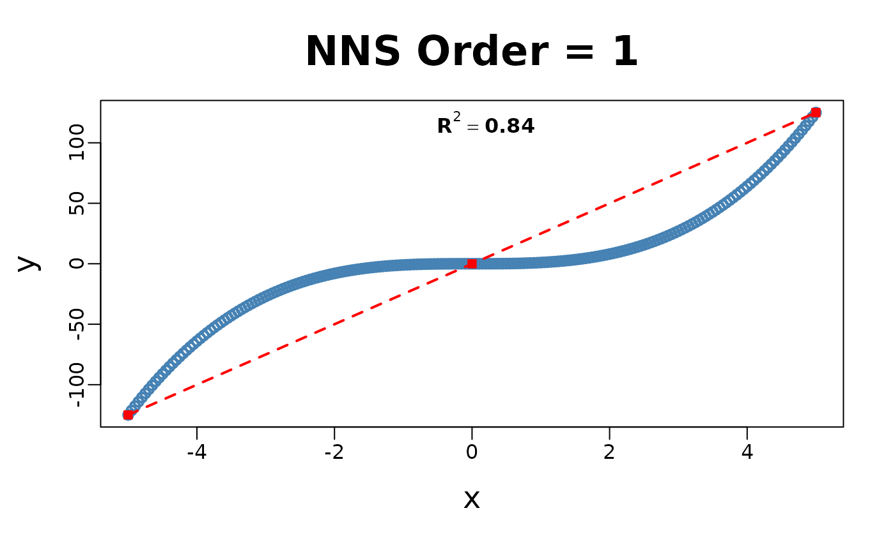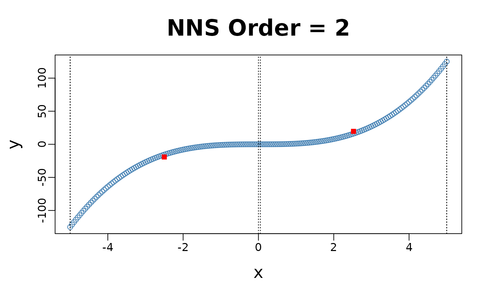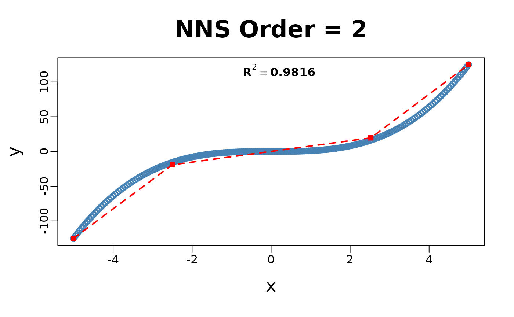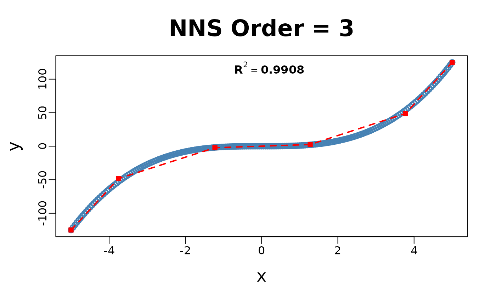

## NNS Regression `NNS.reg()`

**`NNS.reg`** estimates nonlinear relationships in univariate and
multivariate settings using partition summaries and interpolation or
distance weighting. Its fit depends on the observed support, selected
resolution, and reduction rule. The examples below show its main
outputs. Set `type = "REG"` when a numeric response should be treated as
regression even if its values could trigger automatic classification.

### Univariate:

``` r

NNS.reg(x, y, ncores = 1)
```

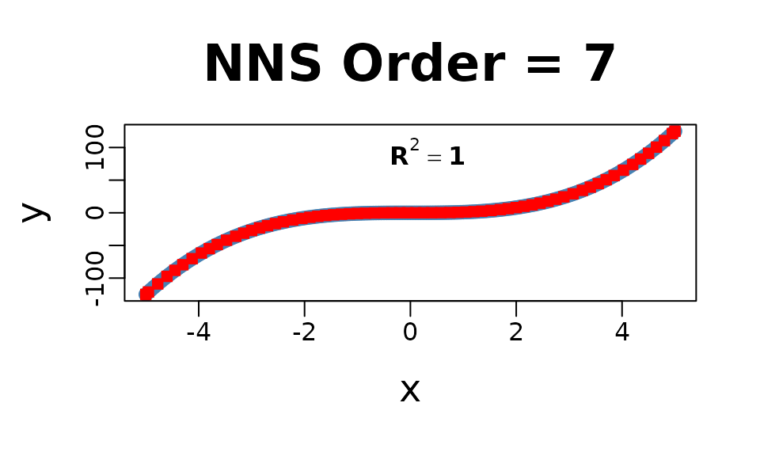

    ## $R2
    ## [1] 0.9999996
    ## 
    ## $SE
    ## [1] 0.04417645
    ## 
    ## $Prediction.Accuracy
    ## NULL
    ## 
    ## $equation
    ## NULL
    ## 
    ## $x.star
    ## NULL
    ## 
    ## $derivative
    ##   Coefficient X.Lower.Range X.Upper.Range
    ## 1    74.25250        -5.000        -4.950
    ## 2    70.76031        -4.950        -4.775
    ## 3    66.10469        -4.775        -4.600
    ## 4    61.43250        -4.600        -4.450
    ## 5    57.42750        -4.450        -4.300
    ## 6    53.08844        -4.300        -4.125
    ## ---
    ## 60     54.8325          4.20          4.35
    ## 61     58.7475          4.35          4.50
    ## 62     62.7975          4.50          4.65
    ## 63     66.9825          4.65          4.80
    ## 64     71.3025          4.80          4.95
    ## 65     74.2525          4.95          5.00
    ## --- [ 65 rows x 3 cols ]; showing first and last 6. Use as.data.frame(x) for all. ---
    ## 
    ## $Point.est
    ## NULL
    ## 
    ## $pred.int
    ## NULL
    ## 
    ## $regression.points
    ##        x          y
    ## 1 -5.000 -125.00000
    ## 2 -4.950 -121.28738
    ## 3 -4.775 -108.90432
    ## 4 -4.600  -97.33600
    ## 5 -4.450  -88.12113
    ## 6 -4.300  -79.50700
    ## ---
    ##       x         y
    ## 61 4.35  82.31287
    ## 62 4.50  91.12500
    ## 63 4.65 100.54463
    ## 64 4.80 110.59200
    ## 65 4.95 121.28738
    ## 66 5.00 125.00000
    ## --- [ 66 rows x 2 cols ]; showing first and last 6. Use as.data.frame(x) for all. ---
    ## 
    ## $Fitted.xy
    ##       x         y     y.hat NNS.ID gradient   residuals
    ## 1 -5.00 -125.0000 -125.0000      1 74.25250  0.00000000
    ## 2 -4.95 -121.2874 -121.2874      2 70.76031  0.00000000
    ## 3 -4.90 -117.6490 -117.7494      2 70.76031 -0.10035937
    ## 4 -4.85 -114.0841 -114.2113      2 70.76031 -0.12721875
    ## 5 -4.80 -110.5920 -110.6733      2 70.76031 -0.08132812
    ## 6 -4.75 -107.1719 -107.2517      3 66.10469 -0.07982812
    ## ---
    ##        x        y    y.hat NNS.ID gradient residuals
    ## 196 4.75 107.1719 107.2429     63  66.9825   0.07100
    ## 197 4.80 110.5920 110.5920     64  71.3025   0.00000
    ## 198 4.85 114.0841 114.1571     64  71.3025   0.07300
    ## 199 4.90 117.6490 117.7223     64  71.3025   0.07325
    ## 200 4.95 121.2874 121.2874     65  71.3025   0.00000
    ## 201 5.00 125.0000 125.0000     65  74.2525   0.00000
    ## --- [ 201 rows x 6 cols ]; showing first and last 6. Use as.data.frame(x) for all. ---
    ## 
    ## $class.levels
    ## NULL

### Multivariate:

Multivariate regressions return a plot of $`y`$ and $`\hat{y}`$, as well
as the regression points (`$RPM`) and partitions (`$rhs.partitions`) for
each regressor.

``` r

f = function(x, y) x ^ 3 + 3 * y - y ^ 3 - 3 * x
y = x ; z <- expand.grid(x, y)
g = f(z[ , 1], z[ , 2])
NNS.reg(z, g, order = "max", plot = FALSE, ncores = 1)
```

    ## $R2
    ## [1] 1
    ## 
    ## $rhs.partitions
    ##    Var1  Var2
    ## 1 -5.00 -5.00
    ## 2 -4.95 -4.95
    ## 3 -4.90 -4.90
    ## 4 -4.85 -4.85
    ## 5 -4.80 -4.80
    ## 6 -4.75 -4.75
    ## ---
    ##     Var1 Var2
    ## 196 4.75 4.75
    ## 197 4.80 4.80
    ## 198 4.85 4.85
    ## 199 4.90 4.90
    ## 200 4.95 4.95
    ## 201 5.00 5.00
    ## --- [ 201 rows x 2 cols ]; showing first and last 6. Use as.data.frame(x) for all. ---
    ## 
    ## $RPM
    ##   Var1  Var2      y.hat
    ## 1   -5 -5.00    0.00000
    ## 2   -5 -4.55  -29.45363
    ## 3   -5 -0.05 -110.14988
    ## 4   -5  0.00 -110.00000
    ## 5   -5  0.05 -109.85012
    ## 6   -5  0.10 -109.70100
    ## ---
    ##       Var1  Var2     y.hat
    ## 40396 -0.1 -0.35 -0.708125
    ## 40397 -0.1 -0.30 -0.574000
    ## 40398 -0.1 -0.25 -0.435375
    ## 40399 -0.1 -0.20 -0.293000
    ## 40400 -0.1 -0.15 -0.147625
    ## 40401 -0.1 -0.10  0.000000
    ## --- [ 40401 rows x 3 cols ]; showing first and last 6. Use as.data.frame(x) for all. ---
    ## 
    ## $Point.est
    ## NULL
    ## 
    ## $pred.int
    ## NULL
    ## 
    ## $Fitted.xy
    ##    Var1 Var2         y     y.hat NNS.ID residuals
    ## 1 -5.00   -5  0.000000  0.000000    1.1         0
    ## 2 -4.95   -5  3.562625  3.562625    2.1         0
    ## 3 -4.90   -5  7.051000  7.051000    3.1         0
    ## 4 -4.85   -5 10.465875 10.465875    4.1         0
    ## 5 -4.80   -5 13.808000 13.808000    5.1         0
    ## 6 -4.75   -5 17.078125 17.078125    6.1         0
    ## ---
    ##       Var1 Var2          y      y.hat  NNS.ID residuals
    ## 40396 4.75    5 -17.078125 -17.078125 196.201         0
    ## 40397 4.80    5 -13.808000 -13.808000 197.201         0
    ## 40398 4.85    5 -10.465875 -10.465875 198.201         0
    ## 40399 4.90    5  -7.051000  -7.051000 199.201         0
    ## 40400 4.95    5  -3.562625  -3.562625 200.201         0
    ## 40401 5.00    5   0.000000   0.000000 201.201         0
    ## --- [ 40401 rows x 6 cols ]; showing first and last 6. Use as.data.frame(x) for all. ---
    ## 
    ## $n.best
    ## [1] 1
    ## 
    ## $dist
    ## [1] "NNS"

### Inter/Extrapolation

`NNS.reg` can inter- or extrapolate any point of interest. The
**`NNS.reg(x, y, point.est = ...)`** parameter permits any sized data of
similar dimensions to $`x`$ and called specifically with
**`NNS.reg(...)$Point.est`**.

### NNS Dimension Reduction Regression

`dim.red.method = "cor"` builds a signed synthetic predictor from the
selected correlations. For a continuous response, `$equation` reports
its coefficients and denominator. The response is fitted as a nonlinear
function of that index; the index itself is not a linear prediction
equation for the response.

``` r

regression_x <- iris[, 2:4]
regression_y <- iris$Sepal.Length
reduced <- NNS.reg(regression_x, regression_y, dim.red.method = "cor",
                   plot = FALSE, ncores = 1)
reduced$equation
```

    ##       Variable Coefficient
    ## 1  Sepal.Width  -0.1667777
    ## 2 Petal.Length   0.8818981
    ## 3  Petal.Width   0.8342888
    ## 4  DENOMINATOR   3.0000000

With retained coefficients $`c_j`$, the index is
$`X^\star = \sum_j c_j X_j / \sum_j \mathbf{1}\{|c_j| > 0\}`$, and the
regression estimates a function $`\hat y = g(X^\star)`$.

#### Threshold

`threshold` retains coefficients whose absolute association meets the
cutoff. This controls which coordinates contribute to the synthetic
index; it does not establish a significance level.

``` r

reduced_threshold <- NNS.reg(regression_x, regression_y,
                            dim.red.method = "cor", threshold = .75,
                            point.est = regression_x[1:10, ],
                            plot = FALSE, ncores = 1)
reduced_threshold$equation
```

    ##       Variable Coefficient
    ## 1  Sepal.Width   0.0000000
    ## 2 Petal.Length   0.8818981
    ## 3  Petal.Width   0.8342888
    ## 4  DENOMINATOR   2.0000000

``` r

reduced_threshold$Point.est
```

    ##  [1] 4.984375 4.984375 4.833689 5.085714 4.984375 5.183574 4.980726 5.085714
    ##  [9] 4.984375 4.831294

## Classification

Set `type = "CLASS"` for nominal classes. Factor, character, logical,
and numeric `0/1` responses are classified automatically. Numeric class
values need not start at one. Factor and character predictions retain
numeric codes with the mapping returned in `$class.levels`.

``` r

classification <- NNS.reg(iris[, 1:4], iris$Species, type = "CLASS",
                          point.est = iris[1:10, 1:4], plot = FALSE, ncores = 1)
classification$class.levels[classification$Point.est]
```

    ##  [1] "setosa" "setosa" "setosa" "setosa" "setosa" "setosa" "setosa" "setosa"
    ##  [9] "setosa" "setosa"

``` r

classification$Point.probabilities
```

    ##       setosa versicolor virginica
    ##  [1,]      1          0         0
    ##  [2,]      1          0         0
    ##  [3,]      1          0         0
    ##  [4,]      1          0         0
    ##  [5,]      1          0         0
    ##  [6,]      1          0         0
    ##  [7,]      1          0         0
    ##  [8,]      1          0         0
    ##  [9,]      1          0         0
    ## [10,]      1          0         0

With dimension reduction, classification uses one signed index per class
indicator. Its `$equation` is therefore a named list, with one equation
per class. Class probabilities are combined before labels are chosen;
the numeric labels are never interpolation coordinates.

``` r

class_reduced <- NNS.reg(iris[, 1:4], iris$Species, dim.red.method = "cor",
                         plot = FALSE, ncores = 1)
class_reduced$equation
```

    ## $setosa
    ##       Variable Coefficient
    ## 1 Sepal.Length  -0.7495899
    ## 2  Sepal.Width   0.6225472
    ## 3 Petal.Length  -0.8173813
    ## 4  Petal.Width  -0.8205282
    ## 5  DENOMINATOR   4.0000000
    ## 
    ## $versicolor
    ##       Variable Coefficient
    ## 1 Sepal.Length  0.11686803
    ## 2  Sepal.Width -0.48249049
    ## 3 Petal.Length  0.01454939
    ## 4  Petal.Width  0.01608235
    ## 5  DENOMINATOR  4.00000000
    ## 
    ## $virginica
    ##       Variable Coefficient
    ## 1 Sepal.Length   0.6327219
    ## 2  Sepal.Width  -0.1400567
    ## 3 Petal.Length   0.8028319
    ## 4  Petal.Width   0.8044458
    ## 5  DENOMINATOR   4.0000000

These examples demonstrate fitted outputs at training observations.
Independent classification accuracy requires heldout observations, as
shown in the classification vignette.

## Cross-Validation `NNS.stack()`

The **`NNS.stack`** routine cross-validates for a given objective
function the `n.best` parameter in the multivariate **`NNS.reg`**
function as well as the `threshold` parameter in the dimension reduction
**`NNS.reg`** version. **`NNS.stack`** can be used for classification:

**`NNS.stack(..., type = "CLASS", ...)`**

or continuous dependent variables:

**`NNS.stack(..., type = "REG", ...)`**.

Any objective function `obj.fn` can be called using
[`expression()`](https://rdrr.io/r/base/expression.html) with the terms
`predicted` and `actual`, even from external packages such as `Metrics`.

**`NNS.stack(..., obj.fn = expression(Metrics::mape(actual, predicted)), objective = "min")`**.

``` r

set.seed(123)
stack_fit <- NNS.stack(IVs.train = iris[, 1:4],
                       DV.train = iris$Species,
                       IVs.test = iris[1:10, 1:4],
                       dim.red.method = "cor",
                       obj.fn = expression(mean(predicted == actual)),
                       objective = "max", type = "CLASS",
                       folds = 1, ncores = 1, status = FALSE)
stack_fit[c("OBJfn.reg", "OBJfn.dim.red", "NNS.reg.n.best",
            "NNS.dim.red.count", "weights", "class.levels")]
```

    ## $OBJfn.reg
    ## [1] 0.9722222
    ## 
    ## $OBJfn.dim.red
    ## [1] 0.8888889
    ## 
    ## $NNS.reg.n.best
    ## [1] 1
    ## 
    ## $NNS.dim.red.count
    ## [1] 1
    ## 
    ## $weights
    ##     reg dim.red 
    ##       1       0 
    ## 
    ## $class.levels
    ## [1] "setosa"     "versicolor" "virginica"

``` r

stack_fit$class.levels[stack_fit$stack]
```

    ##  [1] "setosa" "setosa" "setosa" "setosa" "setosa" "setosa" "setosa" "setosa"
    ##  [9] "setosa" "setosa"

The displayed objectives describe internal tuning folds. The final
predictions above are at supplied training rows and are not an
independent test score. For nominal models, the selected dimension count
is reported directly; a single scalar coefficient threshold cannot
summarize the class-specific equations.

## Increasing Dimensions

A duplicated predictor changes its weight in the multivariate geometry
and can be used to compare that prediction path with univariate
interpolation. It adds no information. Choose this representation and
the neighbor count `n.best` using heldout performance:

**`NNS.stack(IVs.train = cbind(x, x), DV.train = y, method = 1, ...)`**.

``` r

set.seed(123)
x = rnorm(100); y = rnorm(100)

nns.params = NNS.stack(IVs.train = cbind(x, x),
                        DV.train = y,
                        method = 1, ncores = 1)
```

``` r

duplicated_fit <- NNS.reg(cbind(x, x), y,
                          n.best = nns.params$NNS.reg.n.best,
                          point.est = cbind(x, x), plot = FALSE,
                          residual.plot = FALSE, ncores = 1,
                          confidence.interval = .95)
plot(x, y, pch = 19, col = "grey60", main = "Tuned multivariate prediction path")
o <- order(x)
lines(x[o], duplicated_fit$Point.est[o], col = "steelblue", lwd = 2)
```

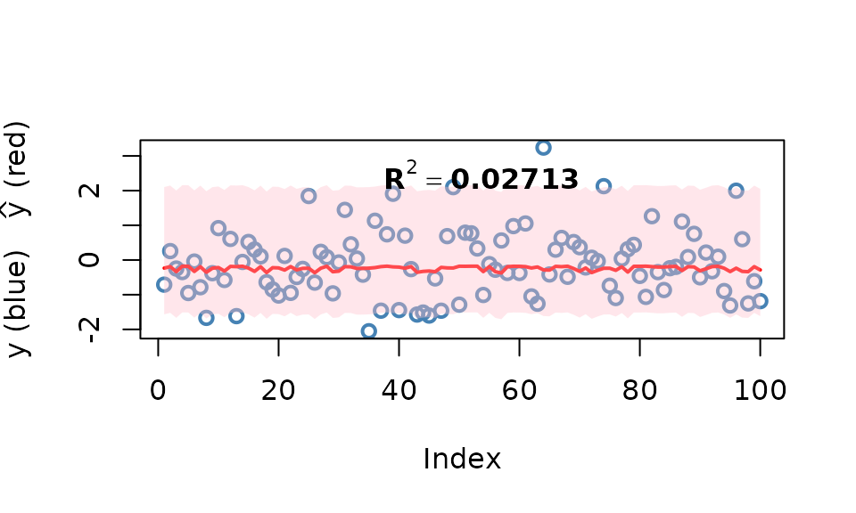

## Smoothing Option

Smoothness is not required for curve fitting, but the `NNS.reg` function
offers an optional smoothed fit. This feature applies a smoothing spline
to regression points generated internally using the partitioning method
described earlier.

``` r

NNS.reg(x, y, smooth = TRUE)
```

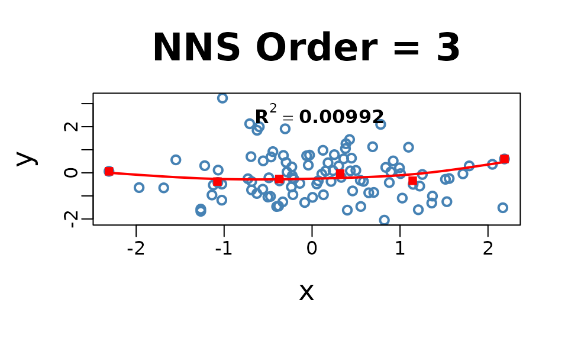

## Imputation

Imputation in `NNS` is a direct application of nearest neighbor
regression. When values of $`y`$ are missing, we use the observed
$`(X,y)`$ pairs as the training set and the predictors of the missing
rows as `point.est`.

A key insight is that even in univariate regressions, `NNS.reg` benefits
from the increasing dimensions trick: by duplicating the predictor into
a multivariate form, e.g. `cbind(x, x)`, the distance function
underlying `NNS.reg` operates in a 2-D space. This sharpened distance
metric allows a more robust donor selection, effectively turning
univariate imputation into a special case of multivariate nearest
neighbor regression.

For multivariate predictors, the same form applies directly — supply the
full set of observed predictors in $`x`$, the observed responses in
$`y`$, and the incomplete rows in `point.est`. With
`order = "max", n.best = 1`, the imputation is always 1-NN donor-based:
each missing $`y`$ is filled in by the response of its closest donor
under the `NNS` hybrid distance. This ensures imputations remain
strictly within the support of the observed data.

**Categorical data** is handled analogously, only requiring
`NNS.reg(..., type = "CLASS")` in the procedure.

### Univariate Imputation

``` r

set.seed(123)

# Univariate predictor with nonlinear signal
n <- 400
x <- sort(runif(n, -3, 3))
y <- sin(x) + 0.2 * x^2 + rnorm(n, 0, 0.25)

# Induce ~25% MCAR missingness in y
miss <- rbinom(n, 1, 0.25) == 1
y_mis <- y
y_mis[miss] <- NA

# ---- Increasing dimensions trick ----
# Duplicate x so the distance operates in a 2D space: cbind(x, x).
# This chooses the multivariate neighbor path; duplication adds no information.
x2_train <- cbind(x[!miss], x[!miss])
x2_miss  <- cbind(x[miss],  x[miss])

# 1-NN donor imputation with NNS.reg
y_hat_uni <- NNS::NNS.reg(
  x         = x2_train,             # predictors (duplicated x)
  y         = y[!miss],             # observed responses
  point.est = x2_miss,              # rows to impute
  order     = "max",                # maximum requested partition order
  n.best    = 1,                    # 1-NN donor
  plot      = FALSE
)$Point.est

# Fill back
y_completed_uni <- y_mis
y_completed_uni[miss] <- y_hat_uni

# Plot observed vs imputed (NNS 1-NN)
plot(x, y, pch = 1, col = "steelblue", cex = 1.5, lwd = 2,
     xlab = "x", ylab = "y", main = "NNS 1-NN Imputation")
points(x[miss], y_hat_uni, col = "red", pch = 15, cex = 1.3)

legend("topleft",
       legend = c("Observed", "Imputed (NNS 1-NN)"),
       col    = c("steelblue", "red"),
       pch    = c(1, 15),
       pt.lwd = c(2, NA),
       bty    = "n")
```

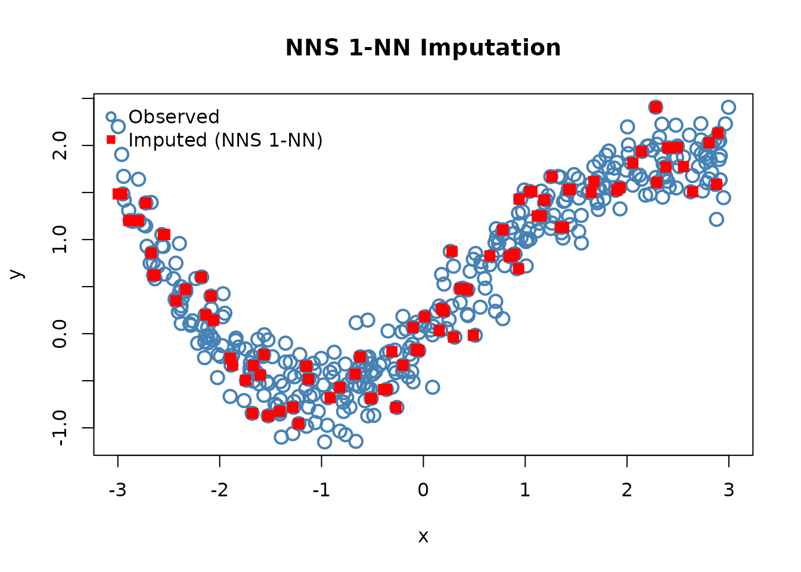

### Multivariate Imputation

``` r

set.seed(123)

# Multivariate predictors with nonlinear & interaction structure
n <- 800
X <- cbind(
  x1 = rnorm(n),
  x2 = runif(n, -2, 2),
  x3 = rnorm(n, 0, 1)
)

f <- function(x1, x2, x3) 1.1*x1 - 0.8*x2 + 0.5*x3 + 0.6*x1*x2 - 0.4*x2*x3 + 0.3*sin(1.3*x1)
y <- f(X[,1], X[,2], X[,3]) + rnorm(n, 0, 0.4)

# Induce ~30% MCAR missingness in y
miss <- rbinom(n, 1, 0.30) == 1
y_mis <- y
y_mis[miss] <- NA

# Training (observed) vs rows to impute
X_obs <- X[!miss, , drop = FALSE]
y_obs <- y[!miss]
X_mis <- X[ miss, , drop = FALSE]

# 1-NN donor imputation with NNS.reg
y_hat_mv <- NNS::NNS.reg(
  x         = X_obs,     # all observed predictors
  y         = y_obs,     # observed responses
  point.est = X_mis,     # rows to impute
  order     = "max",     # maximum requested partition order
  n.best    = 1,         # 1-NN donor
  plot      = FALSE
)$Point.est

# Completed vector
y_completed_mv <- y_mis
y_completed_mv[miss] <- y_hat_mv

# Plot observed vs imputed (multivariate, NNS 1-NN)
plot(seq_along(y), y, 
     pch = 1, col = "steelblue", cex = 1.5, lwd = 2,
     xlab = "Observation index", ylab = "y",
     main = "NNS 1-NN Multivariate Imputation")

# Overlay imputed values
points(which(miss), y_hat_mv, pch = 15, col = "red", cex = 1.2)

# Legend
legend("topleft",
       legend = c("Observed", "Imputed (NNS 1-NN)"),
       col    = c("steelblue", "red"),
       pch    = c(1, 15),
       pt.lwd = c(2, NA),
       bty    = "n")
```

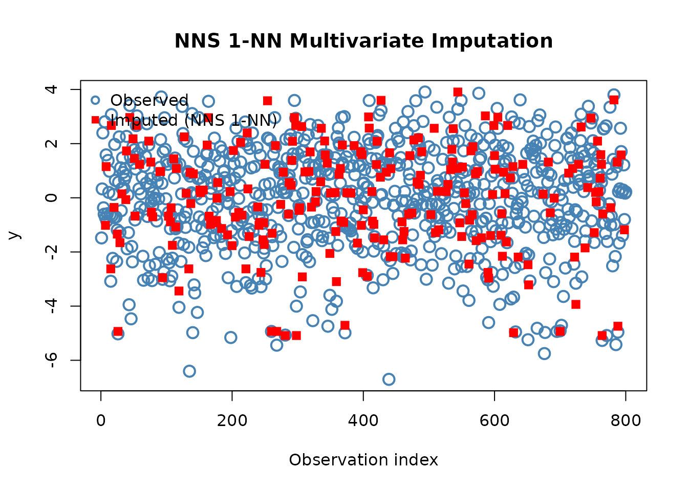

### A Note on Uncertainty Propagation

A completed data set does not by itself represent imputation
uncertainty. Bootstrap model refits can produce multiple completed data
sets, but valid pooled inference also depends on the missingness
assumptions, estimand, imputation design, and sampling calibration.
Applying Rubin’s pooling formula alone does not establish those
conditions. A smaller pooled standard error is not, by itself, evidence
of more accurate uncertainty.

[NNS Multiple Imputation vs
MICE](https://github.com/OVVO-Financial/NNS/blob/NNS-Beta-Version/examples/NNS_MI_vs_MICE.md)
supplies an illustrative simulation. A general comparison requires
repeated samples and assessment of bias, interval coverage, and the
missingness mechanism.

## References

If the user is so motivated, detailed arguments further examples are
provided within the following:

- [Nonlinear Nonparametric Statistics: Using Partial
  Moments](https://ovvo-financial.github.io/NNS/book/)

- [Deriving Nonlinear Correlation Coefficients from Partial
  Moments](https://doi.org/10.2139/ssrn.2148522)

- [Nonparametric Regression Using
  Clusters](https://doi.org/10.1007/s10614-017-9713-5)

- [Clustering and Curve Fitting by Line
  Segments](https://doi.org/10.2139/ssrn.2861339)

- [Classification Using NNS Clustering
  Analysis](https://doi.org/10.2139/ssrn.2864711)

- [Partitional Estimation Using Partial
  Moments](https://doi.org/10.2139/ssrn.3592491)
