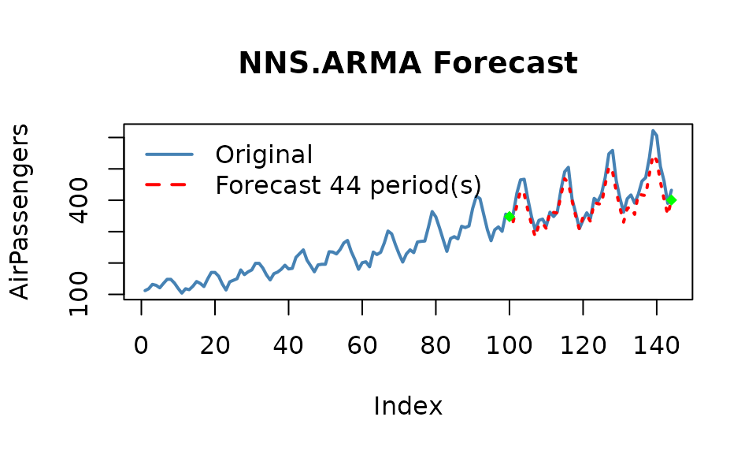
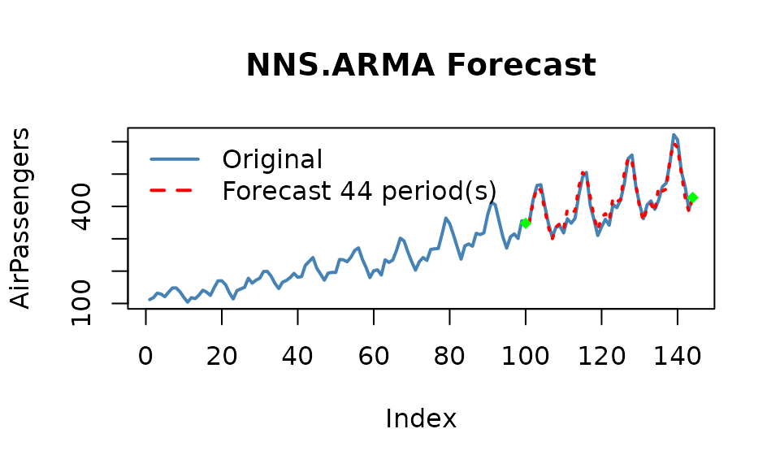
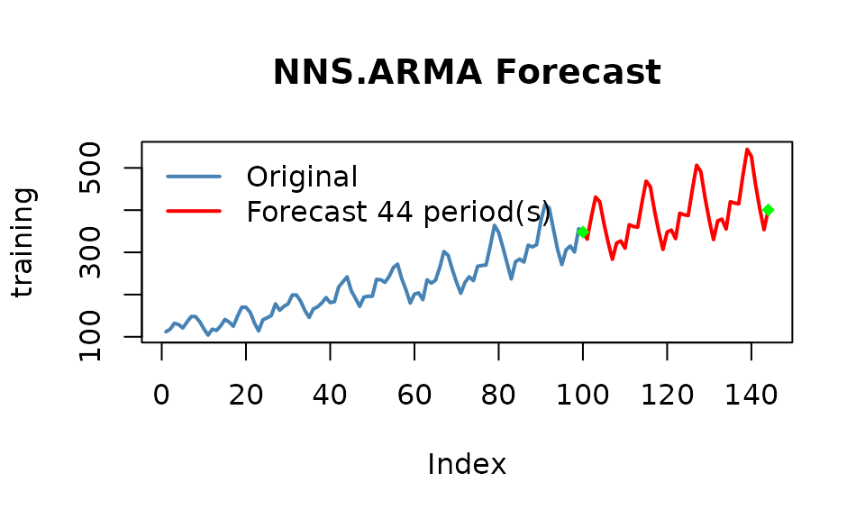
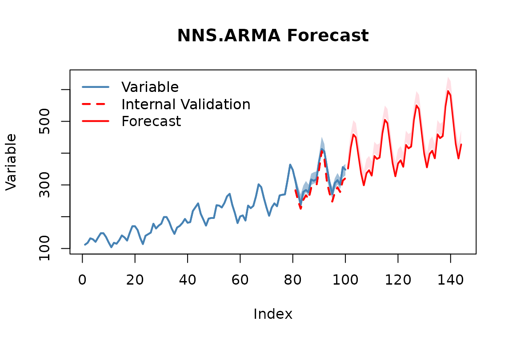
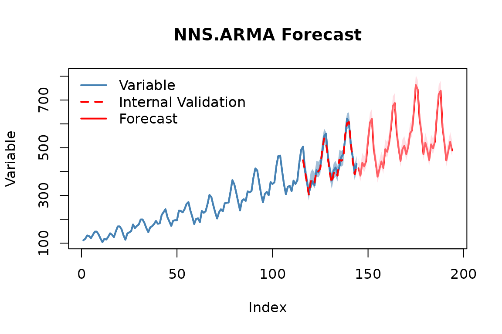

# Getting Started with NNS: Forecasting

## Forecasting

The underlying assumptions of traditional autoregressive models are well
known. The resulting complexity with these models leads to observations
such as,

*\`\`We have found that choosing the wrong model or parameters can often
yield poor results, and it is unlikely that even experienced analysts
can choose the correct model and parameters efficiently given this array
of choices.’’*

`NNS` simplifies the forecasting process. Below are some examples
demonstrating **`NNS.ARMA`** and its partial-moment component
forecasting method. It does not require a parametric distribution
family; predictive assessment still requires a suitable temporal
validation design.

### Linear Regression

**`NNS.ARMA`** has the ability to fit a linear regression to the
relevant component series, yielding very fast results. For our running
example we will use the `AirPassengers` dataset loaded in base R.

We will forecast 44 periods `h = 44` of `AirPassengers` using the first
100 observations `training.set = 100`, returning estimates of the final
44 observations. We will then test this against our validation set of
`tail(AirPassengers,44)`.

Since this is monthly data, we will try a `seasonal.factor = 12`.

Below is the linear fit and associated root mean squared error (RMSE)
using `method = "lin"`.

``` r

nns_lin = NNS.ARMA(AirPassengers,
               h = 44,
               training.set = 100,
               method = "lin",
               plot = TRUE,
               seasonal.factor = 12,
               seasonal.plot = FALSE)
```



``` r

sqrt(mean((nns_lin - tail(AirPassengers, 44)) ^ 2))
```

    ## [1] 35.39965

### Nonlinear Regression

Now we can try using a nonlinear regression on the relevant component
series using `method = "nonlin"`.

``` r

nns_nonlin = NNS.ARMA(AirPassengers,
               h = 44,
               training.set = 100,
               method = "nonlin",
               plot = TRUE,
               seasonal.factor = 12,
               seasonal.plot = FALSE)
```



``` r

sqrt(mean((nns_nonlin - tail(AirPassengers, 44)) ^ 2))
```

    ## [1] 17.90252

The plot and RMSE are computed when this vignette is built, using the
installed NNS version. They describe this fixed training/test split;
historical values are not a performance guarantee.

### Cross-Validation

We select the period using only the first 100 observations. Within that
training prefix, the first 80 observations fit candidate models and
observations 81–100 select the period. The final 44 observations remain
untouched until the selected model is evaluated. Known monthly frequency
is also a legitimate pre-specified choice; selecting a period on those
final 44 outcomes would make their error a tuning score rather than a
test score.

``` r

training <- head(AirPassengers, 100)
inner_n <- 80L
candidates <- 1:16
seas <- data.frame(
  Period = candidates,
  validation_RMSE = vapply(candidates, function(period) {
    predicted <- NNS.ARMA(head(training, inner_n), h = length(training) - inner_n,
                          method = "lin", seasonal.factor = period,
                          plot = FALSE, seasonal.plot = FALSE)
    sqrt(mean((predicted - tail(training, length(training) - inner_n))^2))
  }, numeric(1))
)
a <- seas$Period[which.min(seas$validation_RMSE)]
seas
```

    ##    Period validation_RMSE
    ## 1       1        43.78888
    ## 2       2        43.80467
    ## 3       3        43.10466
    ## 4       4        44.27946
    ## 5       5        46.43585
    ## 6       6        41.88094
    ## 7       7        46.64724
    ## 8       8        46.23633
    ## 9       9        51.19663
    ## 10     10        54.06680
    ## 11     11        56.15792
    ## 12     12        31.63458
    ## 13     13        55.53088
    ## 14     14        67.55522
    ## 15     15        60.16975
    ## 16     16        58.26864

``` r

selected <- NNS.ARMA(training, h = 44, method = "lin", seasonal.factor = a,
                     plot = TRUE, seasonal.plot = FALSE)
```



``` r

sqrt(mean((selected - tail(AirPassengers, 44))^2))
```

    ## [1] 35.39965

This outer test score evaluates one selected procedure. The earlier
linear and nonlinear illustrations are separate pre-specified
comparisons; choosing among them after seeing their test errors would
require a new test period.

**Note:** You may experience instances with monthly data that report
`seasonal.factor` close to multiples of 3, 4, 6 or 12. For instance, if
the reported `seasonal.factor = {37, 47, 71, 73}` use
`(seasonal.factor = c(36, 48, 72))` by setting the `modulo` parameter in
**`NNS.seas(..., modulo = 12)`**. The same suggestion holds for daily
data and multiples of 7, or any other time series with logically
inferred cyclical patterns. The nearest periods to that `modulo` will be
in the expanded output.

``` r

NNS.seas(training, modulo = 12, plot = FALSE)
```

    ## $all.periods
    ##   Period Coefficient.of.Variation Variable.Coefficient.of.Variation
    ## 1     12               0.08014336                         0.1532545
    ## 2     24               0.08386687                         0.1532545
    ## 
    ## $best.period
    ## [1] 12
    ## 
    ## $periods
    ## [1] 12 24

### Selecting Seasonal Factors with `NNS.ARMA.optim`

NNS also offers a wrapper function
**[`NNS.ARMA.optim()`](https://OVVO-Financial.github.io/NNS/reference/NNS.ARMA.optim.md)**
that searches combinations from a supplied vector of `seasonal.factor`
and returns the selected objective value (in this case RMSE written as
`obj.fn = expression( sqrt(mean((predicted - actual)^2)) )`) and the
corresponding periods, as well as the **`NNS.ARMA`** regression method
used. Alternatively, using external package objective functions work as
well such as `obj.fn = expression(Metrics::rmse(actual, predicted))`.

**[`NNS.ARMA.optim()`](https://OVVO-Financial.github.io/NNS/reference/NNS.ARMA.optim.md)**
also compares smoothing the training series, shrinking component
forecasts toward their means, and weighting seasonal estimates. The
default linear approximation uses the linear search to select seasonal
candidates before comparing nonlinear and mixed forecasts. By default it
adds no bias shift (`bias.correction = "none"`); `"split"` estimates a
gravity shift from the first half of the internal validation errors and
accepts it on the later half, and `bias.validation` reports that
decision. These are tuning steps within the first 100 observations.

For this monthly series, we specify periods of 12, 18 and 24 months
before inspecting the reserved test outcomes. Each leaves at least three
observations per phase in the 80-observation inner training window.
Longer candidates up to 60 would be removed by the optimizer’s
sample-support rule for this window, so the code lists the supported
candidates explicitly.

``` r

optimizer_periods <- c(12L, 18L, 24L)
nns.optimal <- NNS.ARMA.optim(training,
                              training.set = inner_n, h = 44,
                              seasonal.factor = optimizer_periods,
                              obj.fn = expression(sqrt(mean((predicted - actual)^2))),
                              objective = "min",
                              ncores = 1, print.trace = FALSE,
                              pred.int = .95, plot = TRUE)
```



``` r

nns.optimal
```

    ## $periods
    ## [1] 12
    ## 
    ## $weights
    ## NULL
    ## 
    ## $obj.fn
    ## [1] 26.17135
    ## 
    ## $method
    ## [1] "nonlin"
    ## 
    ## $shrink
    ## [1] FALSE
    ## 
    ## $nns.regress
    ## [1] FALSE
    ## 
    ## $bias.shift
    ## [1] 0
    ## 
    ## $bias.validation
    ## $bias.validation$policy
    ## [1] "none"
    ## 
    ## $bias.validation$estimated.shift
    ## [1] 0
    ## 
    ## $bias.validation$applied.shift
    ## [1] 0
    ## 
    ## $bias.validation$estimate.rows
    ## integer(0)
    ## 
    ## $bias.validation$acceptance.rows
    ## integer(0)
    ## 
    ## $bias.validation$raw.score
    ## [1] NA
    ## 
    ## $bias.validation$adjusted.score
    ## [1] NA
    ## 
    ## $bias.validation$accepted
    ## [1] FALSE
    ## 
    ## $bias.validation$status
    ## [1] "disabled"
    ## 
    ## 
    ## $raw.results
    ##  [1] 351.5357 416.9881 458.7143 449.3373 392.5159 336.5437 298.9365 336.4444
    ##  [9] 346.3643 329.2791 391.0775 381.8643 386.0959 460.4725 504.8682 494.0918
    ## [17] 430.5114 367.5057 327.2567 367.1606 377.4073 357.0265 425.9934 415.2036
    ## [25] 420.6647 503.5999 550.2190 538.3911 467.7517 397.7587 355.3077 396.9306
    ## [33] 407.5023 383.8903 459.2223 447.3086 453.5746 545.6254 595.4617 581.6900
    ## [41] 504.6181 428.0697 383.3069 427.4418
    ## 
    ## $validation.forecast
    ##  [1] 283.1667 250.8667 225.0667 252.9667 267.4438 255.6970 290.5894 295.0285
    ##  [9] 297.5839 349.4541 406.5728 383.8038 307.7166 273.1074 247.6094 276.5102
    ## [17] 292.4705 277.8527 313.5819 321.0222
    ## 
    ## $errors
    ##  [1] -28.833333 -23.133333 -11.933333 -25.033333 -16.556171 -21.303006
    ##  [7] -26.410601 -17.971519 -20.416139 -24.545886  -6.427215 -21.196203
    ## [13] -47.283360 -32.892616 -23.390559 -29.489847 -22.529482 -23.147274
    ## [19] -42.418145 -26.977785
    ## 
    ## $results
    ##  [1] 351.5357 416.9881 458.7143 449.3373 392.5159 336.5437 298.9365 336.4444
    ##  [9] 346.3643 329.2791 391.0775 381.8643 386.0959 460.4725 504.8682 494.0918
    ## [17] 430.5114 367.5057 327.2567 367.1606 377.4073 357.0265 425.9934 415.2036
    ## [25] 420.6647 503.5999 550.2190 538.3911 467.7517 397.7587 355.3077 396.9306
    ## [33] 407.5023 383.8903 459.2223 447.3086 453.5746 545.6254 595.4617 581.6900
    ## [41] 504.6181 428.0697 383.3069 427.4418
    ## 
    ## $lower.pred.int
    ##  [1] 360.5783 426.0307 467.7569 458.3799 401.5585 345.5863 307.9791 345.4871
    ##  [9] 355.4070 338.3217 400.1201 390.9070 395.1386 469.5152 513.9108 503.1345
    ## [17] 439.5540 376.5483 336.2993 376.2033 386.4499 366.0691 435.0360 424.2463
    ## [25] 429.7073 512.6425 559.2616 547.4337 476.7943 406.8013 364.3503 405.9733
    ## [33] 416.5450 392.9329 468.2650 456.3513 462.6173 554.6680 604.5044 590.7326
    ## [41] 513.6607 437.1123 392.3495 436.4844
    ## 
    ## $upper.pred.int
    ##  [1] 396.5081 461.9605 503.6867 494.3097 437.4883 381.5160 343.9089 381.4168
    ##  [9] 391.3367 374.2515 436.0499 426.8367 431.0683 505.4449 549.8406 539.0642
    ## [17] 475.4838 412.4781 372.2291 412.1330 422.3797 401.9989 470.9658 460.1760
    ## [25] 465.6371 548.5723 595.1914 583.3635 512.7241 442.7310 400.2801 441.9030
    ## [33] 452.4747 428.8627 504.1947 492.2810 498.5470 590.5978 640.4341 626.6624
    ## [41] 549.5905 473.0421 428.2792 472.4142

``` r

c(internal_validation_RMSE = nns.optimal$obj.fn,
  raw_reserved_test_RMSE = sqrt(mean((nns.optimal$raw.results - tail(AirPassengers, 44))^2)),
  corrected_reserved_test_RMSE = sqrt(mean((nns.optimal$results - tail(AirPassengers, 44))^2)))
```

    ##     internal_validation_RMSE       raw_reserved_test_RMSE 
    ##                     26.17135                     17.90252 
    ## corrected_reserved_test_RMSE 
    ##                     17.90252

The optimizer’s `obj.fn` describes its final **internal validation**
forecast. The other two scores evaluate the raw forecast and the
returned, corrected forecast against the reserved final 44 observations.
They are diagnostics; the example does not use them to choose a bias
policy. Selecting a policy from these comparisons would require a new
chronological test window. All values and the returned forecasts are
regenerated at each build. A fitted bias shift is a model parameter, not
proof of persistent future bias.

### Extension of Estimates

We can forecast another 50 periods out-of-sample (`h = 50`), using all
observations now available as training history. The requested interval
level names the residual-quantile construction; future coverage must be
assessed separately.

The longer history supports candidate periods through 36 months under
the optimizer’s default 80% internal training split. This deployment
example has no observed future outcomes to score.

``` r

extended <- NNS.ARMA.optim(AirPassengers,
                            seasonal.factor = seq(12, 36, 6),
                            obj.fn = expression(sqrt(mean((predicted - actual)^2))),
                            objective = "min",
                            ncores = 1, print.trace = FALSE,
                            pred.int = .95, h = 50, plot = TRUE)
```



``` r

head(data.frame(horizon = seq_along(extended$results),
                forecast = extended$results,
                lower = extended$lower.pred.int,
                upper = extended$upper.pred.int))
```

    ##   horizon forecast    lower    upper
    ## 1       1 414.3000 389.7333 455.3167
    ## 2       2 382.7071 358.1405 423.7238
    ## 3       3 437.3357 412.7690 478.3524
    ## 4       4 421.4714 396.9048 462.4881
    ## 5       5 443.2357 418.6690 484.2524
    ## 6       6 533.5429 508.9762 574.5595

### Brief Notes on Other Parameters

- `seasonal.factor = c(1, 2, ...)`

We included the ability to use any number of specified seasonal periods
simultaneously, weighted by their strength of seasonality.
Computationally expensive when used with nonlinear regressions and large
numbers of relevant periods.

- `weights`

Instead of weighting by the `seasonal.factor` strength of seasonality,
we offer the ability to weight each per any defined compatible vector
summing to 1.  
Equal weighting would be `weights = "equal"`.

- `pred.int`

Returns lower and upper bands for each forecasted point from a maximum
entropy bootstrap of the forecast path, and plots the bootstrapped
replicates. The band describes how dispersed the forecast path is, not
the probability that future values fall inside it: it does not widen
with the horizon and is not calibrated to the nominal level.
`NNS.ARMA.optim` builds its interval from validation errors instead.

- `seasonal.factor = FALSE`

We also included the ability to use all detected seasonal periods
simultaneously, weighted by their strength of seasonality.
Computationally expensive when used with nonlinear regressions and large
numbers of relevant periods.

- `best.periods`

This parameter restricts the number of detected seasonal periods to use,
again, weighted by their strength. To be used in conjunction with
`seasonal.factor = FALSE`.

- `modulo`

To be used in conjunction with `seasonal.factor = FALSE`. This parameter
will ensure logical seasonal patterns (i.e., `modulo = 7` for daily
data) are included along with the results.

- `mod.only`

To be used in conjunction with
`seasonal.factor = FALSE & modulo != NULL`. With `mod.only = TRUE`
(default), only periods at multiples of `modulo` are kept: each detected
period is replaced by the multiples of `modulo` on either side of it
(period 7 with `modulo = 5` gives 5 and 10). Set `mod.only = FALSE` to
keep the empirically detected periods along with the logical seasonal
patterns.

- `dynamic = TRUE`

This setting generates a new seasonal period(s) using the estimated
values as continuations of the variable, either with or without a
`training.set`. Also computationally expensive due to the recalculation
of seasonal periods for each estimated value.

- `plot` , `seasonal.plot`

These are the plotting arguments, easily enabled or disabled with `TRUE`
or `FALSE`. `seasonal.plot = TRUE` will not plot without `plot = TRUE`.
If a seasonal analysis is all that is desired, `NNS.seas` is the
function specifically suited for that task.

## Multivariate Time Series Forecasting

The extension to a generalized multivariate instance is provided in the
following documentation of the
**[`NNS.VAR()`](https://OVVO-Financial.github.io/NNS/reference/NNS.VAR.md)**
function:

- [Multivariate Time Series Forecasting: Nonparametric Vector
  Autoregression Using NNS](https://doi.org/10.2139/ssrn.3489550)

## References

If the user is so motivated, detailed arguments and proofs are provided
within the following:

- [Nonlinear Nonparametric Statistics: Using Partial
  Moments](https://ovvo-financial.github.io/NNS/book/)

- [Forecasting Using NNS](https://doi.org/10.2139/ssrn.3382300)
