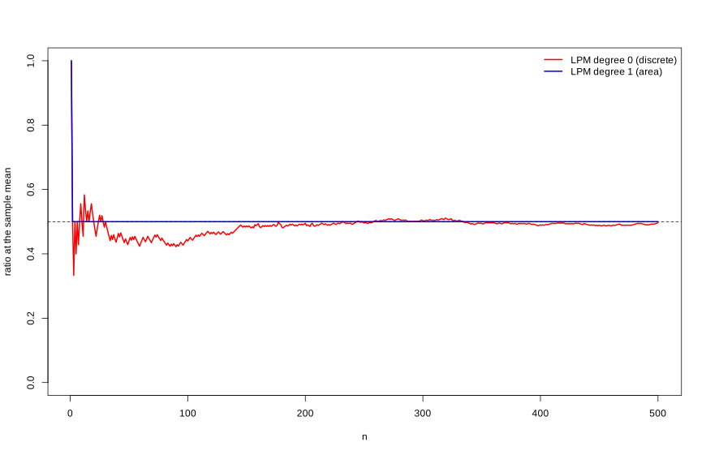

# Distribution Comparison

Previous chapters developed the directional framework for describing distributions, dependence, and conditional probability. Distribution estimation in Chapter 8 showed how empirical partial moments provide nonparametric estimates of entire distributions, while Chapters 9–14 demonstrated how directional moments reveal dependence, conditional probability, and causal structure.

A natural next question is how to **compare distributions**.

Classical statistics typically approaches this problem through **hypothesis testing**. Tests such as the Kolmogorov–Smirnov test, the Mann–Whitney test, or parametric t-tests attempt to determine whether two samples arise from the same underlying distribution.

While useful, these procedures emphasize **binary decisions**—reject or fail to reject a null hypothesis—rather than describing how distributions actually differ.

The directional framework approaches distribution comparison differently. Because partial moments characterize probability mass relative to benchmarks, two distributions can be compared directly through their **directional probability structure**.

This chapter develops a nonparametric approach to distribution comparison based on directional probability measures and effect-size interpretations rather than hypothesis-testing decisions. It then introduces the NNS ANOVA procedure, which operationalizes these ideas through the LPM-based continuous CDF, adds **stochastic superiority** as the fundamental pairwise effect-size comparison, and concludes with stochastic dominance tests that extend the comparison to ordered preference relations.

---

This chapter is organized into four signposted blocks so readers can move from concepts to implementation: **Block I (Theory)** develops comparison logic and the continuous deviation-area representation; **Block II (Estimation mechanics)** defines operational estimators including stochastic superiority and NNS ANOVA; **Block III (Diagnostics)** covers dominance curves and ordered-comparison diagnostics; **Block IV (Applied workflow)** provides examples and practical guidance.

## Block I — Theory and foundational comparisons

### Classical Hypothesis Testing

In classical statistics, comparing two distributions usually begins with a **null hypothesis**

$$
H_0: F_X(t) = F_Y(t) \quad \text{for all } t.
$$

The alternative hypothesis states that the two distributions differ.

Several classical tests address this problem.

### Kolmogorov–Smirnov Test

The Kolmogorov–Smirnov statistic compares the empirical distribution functions

$$
D = \sup_t |\hat F_X(t) - \hat F_Y(t)|.
$$

Large values of $D$ indicate that the distributions differ.

### Mann–Whitney Test

The Mann–Whitney test evaluates whether observations from one sample tend to be larger than those from another sample.

### Parametric Tests

When parametric assumptions are imposed, tests such as the t-test compare population means.

Although widely used, these methods possess several limitations.

**Binary interpretation.**  
Hypothesis tests produce accept–reject decisions rather than quantitative descriptions of differences.

**Sample-size dependence.**  
With large samples, even trivial differences become statistically significant.

**Model dependence.**  
Parametric tests require assumptions about distributional form.

**Limited directional insight.**  
Most classical tests provide little information about how distributions differ across regions of the support.

The directional framework emphasizes **probability comparisons and effect sizes** instead.

---

### Nonparametric Distribution Comparison

Let $X$ and $Y$ be two random variables with distributions $F_X$ and $F_Y$.

A natural way to compare the distributions is to examine the probability that an observation from one distribution exceeds an observation from the other.

Define independent draws

$$
X' \sim F_X, \qquad Y' \sim F_Y.
$$

Consider the probability

$$
P(X' > Y').
$$

This quantity measures how frequently values from distribution $X$ exceed values from distribution $Y$.

Similarly,

$$
P(Y' > X')
$$

measures the opposite directional comparison.

Because

$$
P(X' > Y') + P(Y' > X') + P(X'=Y') = 1,
$$

these probabilities provide a complete comparison of the two distributions.

For continuous distributions, ties occur with probability zero, so

$$
P(X' > Y') + P(Y' > X') = 1.
$$

For discrete distributions, ties occur with positive probability. In this case, use the tie-adjusted directional probability

$$
p^* = P(X' > Y') + \tfrac{1}{2}P(X' = Y').
$$

This preserves symmetry and keeps the directional comparison centered at $0.5$ when the two distributions have no directional superiority over one another.

This simple probability comparison already provides more information than a binary hypothesis test: it directly measures **which distribution tends to produce larger outcomes**.

---

### Directional Probability and Effect Size

The directional probability

$$
p = P(X' > Y')
$$

has a natural interpretation as an **effect-size measure**.

- $p = 0.5$ indicates no net pairwise directional advantage. Different distributions, such as $\{-1,1\}$ and $\{-10,10\}$, can have this same value.
- $p > 0.5$ indicates that $X$ tends to produce larger values.
- $p < 0.5$ indicates that $Y$ tends to produce larger values.

Unlike hypothesis testing, this directional probability does not depend on arbitrary significance thresholds and remains directly interpretable as a frequency statement. If one reports the symmetric certainty transform $C = |2p - 1|$, then $C = 0$ corresponds to no directional superiority, which can occur for different distributions; $C = 1$ indicates complete separation in the pairwise comparison.

---

### Directional Probability Comparisons

Directional probability comparisons can be extended using partial moments.

Let $t$ be a benchmark. The probability that $X$ exceeds the benchmark while $Y$ does not is

$$
P(X > t,\, Y \le t).
$$

Similarly,

$$
P(Y > t,\, X \le t)
$$

measures the opposite directional region.

Within the partial-moment framework, these probabilities correspond to **degree-zero divergent co-partial moments**:

$$
DUPM_{0,0}(t,t) = P(X > t,\, Y \le t),
$$

$$
DLPM_{0,0}(t,t) = P(X \le t,\, Y > t).
$$

The difference

$$
\Delta(t) = DUPM_{0,0}(t,t) - DLPM_{0,0}(t,t)
$$

indicates which distribution dominates relative to the benchmark.

- If $\Delta(t) > 0$, distribution $X$ more frequently exceeds the benchmark.
- If $\Delta(t) < 0$, distribution $Y$ does.

By examining $\Delta(t)$ across a range of benchmarks, analysts obtain a **directional dominance curve** describing where one distribution exceeds the other.

---

### The Discrete–Continuous CDF Distinction

Before developing operational comparison procedures, it helps to separate two answers to the question "how much of the distribution lies below a benchmark?": a share of observations and a share of deviation area. They agree only in special cases, and the difference matters for distribution comparison.

#### The Empirical CDF as a Discrete Measure

The empirical cumulative distribution function is identical to the **degree-zero lower partial moment ratio**:

$$
\hat{F}_X(t) = L_0(t; X) = \frac{1}{n} \sum_{i=1}^n \mathbf{1}_{\{x_i \le t\}},
$$

where $\mathbf{1}_{\{\cdot\}}$ is the indicator function. This is a **discrete** probability measure: it assigns probability mass only at observed data points and is a step function everywhere else. Even with one million observations, it remains a step function — it is never truly continuous.

A direct consequence of this discreteness is that its value at the sample mean,

$$
\hat{F}_X(\bar{x}) = \frac{1}{n}\sum_{i=1}^n \mathbf{1}_{\{x_i \le \bar{x}\}},
$$

moves in steps of $1/n$ and scatters from sample to sample. It is a plug-in estimate of $P(X \le \mu)$. For independent samples of size at least two from a continuous distribution symmetric about its finite mean, its expectation is 0.5 by reflection symmetry; individual samples fluctuate (0.44 in the example below). For an asymmetric distribution the target need not be 0.5: for an exponential, $P(X \le \mu) = 1 - e^{-1} \approx 0.632$.

At a shared benchmark, two empirical CDFs can differ through sampling variability even when the underlying distributions agree. This variability must be separated from the choice of target: event frequency, mean agreement, and deviation-area agreement are different questions.

#### The Degree-One Partial Moment Ratio: a Share of Deviation Area

The directional framework offers a second measure, which replaces the discrete indicator with **area-based mass** in the degree-one lower partial moment ratio:

$$
F_1(t; X) = \frac{LPM_1(t, X)}{LPM_1(t, X) + UPM_1(t, X)},
$$

where

$$
LPM_1(t, X) = \frac{1}{n} \sum_{i=1}^n \max(0,\, t - x_i),
\qquad
UPM_1(t, X) = \frac{1}{n} \sum_{i=1}^n \max(0,\, x_i - t).
$$

Rather than counting the fraction of observations below $t$, this ratio measures the fraction of the **total area of deviations** that lies below $t$. Each observation is weighted by its distance from $t$, so this is a severity-weighted share, not the probability $P(X \le t)$: for an exponential sample, the point with 5% of the deviation area below it has about a quarter of the observations below it. That point is the 5% expectile (Newey and Powell, 1987): the degree-one ratio is the inverse of the expectile function, as the degree-zero ratio is the inverse of the quantile function. What the degree-one ratio offers instead is continuity in $t$, where the empirical CDF jumps by $1/n$, and the distribution-free anchor derived next. Probability statements about the original variable, such as event frequencies and ordinary quantiles, use degree 0. For a nondegenerate integrable variable, the univariate $F_1$ is itself continuous, increasing, and has limits 0 and 1, so it is a valid induced CDF. Its induced law differs from the original law; continuity does not erase this distinction.

In NNS, this is computed via `LPM.ratio(degree = 1, target, variable)`.

#### The Mean-Target Property

A fundamental property follows from the algebraic structure of the degree-one ratio.

**Theorem.** For any nonconstant sample $x_1, \dots, x_n$,

$$
F_1(\bar{x};\, X) = 0.5
$$

exactly, where $\bar{x} = \frac{1}{n}\sum_{i=1}^n x_i$ is the sample mean.

**Proof.** Observe that pointwise,

$$
(t - x_i)^+ - (x_i - t)^+ = t - x_i
$$

for every $i$ and every $t$. Setting $t = \bar{x}$ and summing over $i$:

$$
\sum_{i=1}^n (t - x_i)^+ - \sum_{i=1}^n (x_i - t)^+ = \sum_{i=1}^n (\bar{x} - x_i) = n\bar{x} - \sum_{i=1}^n x_i = 0.
$$

Therefore $LPM_1(\bar{x}, X) = UPM_1(\bar{x}, X)$, which gives $F_1(\bar{x}; X) = 0.5$ exactly. $\square$

This sample identity holds for **every nonconstant sample without parametric assumptions**. It is a property of the area-based share, not a correction of the empirical CDF: the empirical CDF at the mean estimates $P(X \le \mu)$, which is 0.5 for a continuous distribution symmetric about its mean, but not in general, while the degree-one ratio is 0.5 at the mean by construction. The same identity gives $LPM_1(t, X) - UPM_1(t, X) = t - \bar{x}$ at every benchmark, so

$$
F_1(t; X) - \frac{1}{2} = \frac{t - \bar{x}}{2\,\big(LPM_1(t, X) + UPM_1(t, X)\big)}:
$$

at any benchmark, the degree-one ratio's distance from 0.5 is the distance from the sample mean, scaled by the deviation area.

The same argument extends to the population: $F_1(\mu_X; X) = 0.5$ exactly for the population mean $\mu_X$, for any nondegenerate distribution with finite absolute first moment. At a constant sample's only value both directional areas vanish; the package uses its documented step convention rather than the ratio $0/0$.

#### Empirical Demonstration

The contrast between the two representations is immediately visible in data:

```r
library(NNS)

set.seed(12345)
x <- rnorm(100, mean = 5, sd = 1)

# Share of observations at or below the mean
LPM.ratio(0, mean(x), x)
## [1] 0.44

# Share of deviation area below the mean: 0.5 by construction
LPM.ratio(1, mean(x), x)
## [1] 0.5
```

With 100 observations, 44% of this normal sample lies at or below its mean, against 50% in the population; the share scatters around 0.5 from sample to sample. The degree-one ratio returns exactly 0.5. With 500 observations the scatter is smaller:

```r
set.seed(12345)
x2 <- rnorm(500, mean = 5, sd = 1)

LPM.ratio(0, mean(x2), x2)   # share of observations
## [1] 0.496

LPM.ratio(1, mean(x2), x2)   # share of deviation area
## [1] 0.5
```

Tracking both measures sequentially across every observation of a normal sample shows the degree-zero ratio scattering around 0.5 and settling only as $n$ grows, while the degree-one ratio is pinned at exactly 0.5 throughout:

```r
set.seed(12345)
x <- rnorm(500)

lpm0 <- numeric(length(x))
lpm1 <- numeric(length(x))

for (i in seq_along(x)) {
    lpm0[i] <- LPM.ratio(0, mean(x[1:i]), x[1:i])
    lpm1[i] <- LPM.ratio(1, mean(x[1:i]), x[1:i])
}

plot(lpm0, col = "red",  type = "l", lwd = 2,
     ylim = c(0, 1), ylab = "ratio at the sample mean", xlab = "n")
lines(lpm1, col = "blue", lwd = 2)
abline(h = 0.5, lty = 2)
legend("topright", legend = c("LPM degree 0 (discrete)",
                               "LPM degree 1 (area)"),
       col = c("red", "blue"), lwd = 2, bty = "n")
```

<center>

</center>

The red line wanders; the blue line is flat at 0.5 from $n = 2$ on. (A single observation has no deviation area on either side, and `LPM.ratio` then returns 1, as degree zero does.)

The full demonstration in Python:

```python
import numpy as np
from nns import lpm_ratio

rng = np.random.default_rng(12345)
x = rng.normal(loc=5, scale=1, size=100)

# Share of observations at or below the mean
lpm_ratio(0, float(np.mean(x)), x)

# Share of deviation area below the mean: 0.5 by construction
lpm_ratio(1, float(np.mean(x)), x)

x2 = rng.normal(loc=5, scale=1, size=500)
lpm_ratio(0, float(np.mean(x2)), x2)   # share of observations
lpm_ratio(1, float(np.mean(x2)), x2)   # share of deviation area

# Sequential tracking across every observation
x = rng.normal(size=500)
lpm0 = np.array([lpm_ratio(0, float(np.mean(x[:i])), x[:i]) for i in range(1, x.size + 1)])
lpm1 = np.array([lpm_ratio(1, float(np.mean(x[:i])), x[:i]) for i in range(1, x.size + 1)])
```

#### Implications for Distribution Comparison

This property has direct consequences for the comparison methods developed in the remainder of this chapter.

When two samples $X$ and $Y$ are evaluated at a shared benchmark such as the grand mean $\bar{z}$, the identity above makes $F_1(\bar{z}; X) - 0.5$ the distance from $\bar{z}$ to the group mean $\bar{x}$, in units of that group's deviation area, whatever the shape of the distribution. Under the null hypothesis of identical population means, both $F_1(\bar{z}; X)$ and $F_1(\bar{z}; Y)$ scatter around 0.5 with sampling noise, and departures from 0.5 measure how far each group mean sits from the grand statistic.

The discrete CDF has no such anchor. Its value at the mean estimates $P(X \le \mu)$, which is 0.5 for a continuous distribution symmetric about its mean, but not in general, so at degree 0 a departure from 0.5 mixes skewness with separation: two identical exponential groups both sit near 0.632, not 0.5.

The NNS ANOVA procedure in Section 15.4.2 is built directly on this foundation.

---

## Block II — Estimation mechanics

### Empirical Estimation

These probability comparisons can be estimated directly from sample data.

Let

$$
x_1,\dots,x_n \sim X, \qquad y_1,\dots,y_m \sim Y.
$$

An empirical estimator of $P(X > Y)$ is

$$
\hat p = \frac{1}{nm} \sum_{i=1}^n \sum_{j=1}^m \mathbf{1}_{\{x_i > y_j\}}.
$$

This statistic measures the proportion of cross-sample comparisons in which an observation from $X$ exceeds one from $Y$.

The estimator converges to the population probability by the law of large numbers.

This estimator requires no parametric assumptions and uses the full sample information.

---

## Block III — Diagnostics and dominance analysis

### Directional Dominance Curves

Benchmark-based comparisons extend this idea further.

Define

$$
\hat \Delta(t) = \hat P(X>t,\,Y\le t) - \hat P(Y>t,\,X\le t).
$$

Plotting $\hat\Delta(t)$ across benchmarks produces a **directional dominance curve**.

Interpretation:

- Positive values indicate regions where distribution $X$ dominates.
- Negative values indicate regions where distribution $Y$ dominates.
- Values near zero indicate similar behavior.

Unlike scalar summary statistics, this curve reveals **where along the distribution the differences occur**.

For example, one distribution may dominate in the upper tail while the other dominates in the lower tail.

Directional dominance curves therefore provide a detailed nonparametric comparison of distributions.

---


### Severity-Weighted Distribution Comparison

Distribution comparison need not stop at asking which sample places more probability mass below a threshold. The directional framework allows a stronger question: how quickly does adverse severity accumulate below that threshold?

For a benchmark \(t\), degree-zero comparison evaluates
\[
L_0(t;X)=P(X\le t),
\]
which is purely frequency-based. Degree one evaluates
\[
L_1(t;X)=E[(t-X)_+],
\]
which aggregates the total adverse deviation below the benchmark. Degree two evaluates
\[
L_2(t;X)=E[(t-X)_+^2],
\]
which penalizes larger deviations disproportionately.

These degrees therefore define a general hierarchy:
\[
\text{degree 0} \to \text{event frequency},
\]
\[
\text{degree 1} \to \text{aggregate adverse magnitude},
\]
\[
\text{degree 2} \to \text{extreme-deviation sensitivity}.
\]

This hierarchy is useful in any setting where two distributions can have similar lower-tail frequency but very different lower-tail severity. A system may violate a benchmark only slightly more often than another system, yet do so with much larger deviations once the benchmark is crossed. Frequency alone would miss that distinction; higher-degree partial moments make it visible.

The probability-bounds literature uses this same logic in discussions of partial-moment-ratio thresholds, though often in finance terminology. Here the broader point is more important than the label: a threshold comparison can be performed either in count space or in severity-weighted space.


## Block IV — Applied workflow and practical inference


### Practical Threshold Comparison Across Degrees

A practical directional workflow for comparing distributions is therefore to evaluate lower-tail structure degree by degree.

First, compare degree-zero lower-tail probabilities to assess how often observations fall below the benchmark. This recovers the familiar CDF-based comparison.

Second, compare degree-one lower partial moments to assess how much aggregate adverse magnitude accumulates below the benchmark.

Third, compare degree-two lower partial moments when larger deviations deserve disproportionate emphasis.

This layered comparison is useful across domains. In forecasting, it distinguishes models that miss a target equally often but differ in the magnitude of their misses. In operations, it distinguishes supply systems that stock out with similar frequency but very different shortage depth. In reliability, it distinguishes designs whose failure margins are crossed with similar probability but different severity once crossed.

This section also clarifies why the degree-one area representation matters. Section 15.1.8 showed that the degree-one partial-moment ratio is continuous in the benchmark and anchored at 0.5 at the mean of every non-constant sample. That same area-based logic provides a smoother path from event counting to severity-weighted comparison.


### Example

Suppose two samples represent outcomes from two strategies.

Sample $X$:

$$
-2, -1, 1, 3, 4
$$

Sample $Y$:

$$
-3, -2, 0, 2, 2
$$

Compute cross-sample comparisons.

There are $5 \times 5 = 25$ comparisons.

Counting cases where $x_i > y_j$ yields

$$
\hat p = 0.64.
$$

Interpretation:

- Distribution $X$ tends to produce larger values than $Y$.
- The estimated directional exceedance probability is $0.64$, indicating moderate directional advantage for $X$.

This effect-size interpretation provides a clear and intuitive comparison without invoking hypothesis tests.

---

### NNS ANOVA: CDF-Based Distribution Comparison

The directional framework motivates a fully operational procedure for comparing distributions. The NNS ANOVA method uses the degree-one lower partial moment CDF developed in Section 15.1.8 and evaluates distributional similarity across both the grand mean and selected quantiles.

To avoid notation ambiguity, this section uses a dedicated symbol, $C_{\text{ANOVA}}$, for the NNS ANOVA certainty score.

#### The LPM-Based Continuous CDF

The degree-one partial moment CDF established in Section 15.1.8 provides the measurement foundation for NNS ANOVA. Recall that

$$
F_1(t; X) = \frac{LPM_1(t, X)}{LPM_1(t, X) + UPM_1(t, X)},
$$

and that $F_1(\bar{x}; X) = 0.5$ exactly at the sample mean for every non-constant sample.

This **mean-target property** provides a distribution-free anchor for comparing means across samples: under the null that two groups share a common population mean, both groups' degree-one CDFs evaluated at the grand mean scatter around 0.5, and a departure from 0.5 measures the distance between the group mean and the grand mean in units of that group's deviation area (Section 15.1.8). Because the anchor does not depend on the shape of either distribution, a skewed group is not read as a shifted one, as it would be by comparing the empirical CDF with 0.5.

The degree-one CDF is also continuous in $t$, unlike the empirical step function, because it encodes area-based mass rather than point counts. That smoothness is not robustness: deviations enter in proportion to their size, so a single extreme observation shifts the degree-one CDF at every $t$, while it changes the degree-zero CDF by one count. Chapter 17 gives a numerical example for the tail thresholds.

#### Grand Mean and the NNS Certainty Statistic

To compare two distributions, NNS ANOVA proceeds as follows.

Let $x_1, \dots, x_n$ and $y_1, \dots, y_m$ denote the control and treatment samples. The **grand statistic** is the sample-size weighted mean of the two group means:

$$
\bar{z} = \frac{n\bar{x} + m\bar{y}}{n + m}.
$$

This pooled form ensures the reference point reflects the actual composition of the combined sample, giving appropriately greater weight to whichever group contributes more observations.

Each sample's degree-one partial moment CDF is evaluated at $\bar{z}$:

$$
F_1(\bar{z}; X), \qquad F_1(\bar{z}; Y).
$$

Under a common population mean, the sample means and pooled mean fluctuate. The mean-target identity makes each degree-one departure from 0.5 a scaled measure of its sample mean's distance from the pooled mean. Its sampling distribution still depends on sample sizes and distributional shape.

The NNS ANOVA certainty statistic is computed from five deviation terms. Let $\delta_0$ denote the maximum absolute deviation of either group's CDF from 0.5 at the grand mean, capped at 0.5:

$$
\delta_0 = \min\!\bigl(0.5,\, \max(|F_1(\bar{z}; X) - 0.5|,\, |F_1(\bar{z}; Y) - 0.5|)\bigr).
$$

Four additional terms compare tail-area targets. For $p=0.25$ and $p=0.125$, the lower target averages `LPM.VaR(p, 1, .)` across the groups; the upper target averages `UPM.VaR(p, 1, .)`. Thus these are lower $p$ and upper $(1-p)$ expectile benchmarks. At the lower target compare each group's LPM ratio with $p$; at the upper target compare its UPM ratio with $p$. Take the maximum absolute departure across groups and cap it at $p$.

The full-distribution certainty statistic is then

$$
\begin{aligned}
\text{Certainty}_{\text{ANOVA, raw}}
&= \frac{1}{2.5} \Bigg[
\frac{(0.5 - \delta_0)^2}{0.25}
+ 0.5 \cdot \frac{(0.25 - \delta_{0.25}^{U})^2}{0.0625} \\
&\qquad + 0.5 \cdot \frac{(0.25 - \delta_{0.25}^{L})^2}{0.0625}
+ 0.25 \cdot \frac{(0.125 - \delta_{0.125}^{U})^2}{0.015625} \\
&\qquad + 0.25 \cdot \frac{(0.125 - \delta_{0.125}^{L})^2}{0.015625}
\Bigg].
\end{aligned}
$$

Each term is a squared relative deviation from its null value, weighted by benchmark coverage so central benchmarks dominate the score while outer-tail benchmarks remain contributory but less influential. The mean benchmark receives weight 1 because it is the primary location anchor; each 25% tail benchmark receives 0.5 because it targets one-quarter tail regions on each side; and each 12.5% extreme-tail benchmark receives 0.25 to avoid overweighting sparse extremes. The sum is normalized by total weight 2.5. In means-only mode, only the first term is used and divided by 1 rather than 2.5.

For median comparison, let $t$ be the pooled median. A group has $t$ as a median exactly when $F(t-) \le 1/2 \le F(t)$. Its central discrepancy is therefore

$$
d(t)=\max\{0,\;F(t-)-1/2,\;1/2-F(t)\}.
$$

Use the larger group discrepancy as $\delta_0$. This equals the absolute distance from $F(t)$ to one half when there is no atom at $t$, and correctly allows a CDF jump containing one half when values are tied. The returned `Control_CDF` and `Treatment_CDF` remain the inclusive degree-zero values $F(t)$. When `means.only = FALSE`, the four degree-one tail-area comparisons are still included; the median option changes the central target.

If a group is constant at a benchmark, both degree-one areas vanish and the expectile balance holds at every level. ANOVA assigns zero area discrepancy to that group at that benchmark instead of treating the public CDF's degenerate step convention as evidence of disagreement. This makes identical constant groups agree maximally while preserving the distinction between a constant group and a variable group with the same mean: they agree centrally but can differ in their tail profile. Returned `Control_CDF` and `Treatment_CDF` values retain the package's CDF convention.

A **population size adjustment** is applied before the final certainty is returned:

$$
\text{Certainty}_{\text{ANOVA}} = \min\!\left(1,\; \text{Certainty}_{\text{ANOVA, raw}} \times \left(\frac{n + m - 2}{n + m}\right)^2\right).
$$

This correction reduces certainty modestly for small combined samples, reflecting the increased estimation uncertainty when fewer observations inform the CDF comparisons. As $n + m \to \infty$ the adjustment approaches one and becomes negligible.

The raw score equals 1 at maximal benchmark agreement. After the finite-sample adjustment, the maximum is $((n+m-2)/(n+m))^2$, below 1 for finite nonempty groups. Smaller values describe stronger disagreement at the selected benchmarks; agreement of this finite profile does not establish equality of distributions.

This formulation inverts the conventional hypothesis-testing orientation: rather than a p-value measuring evidence against the null, the certainty statistic directly expresses the degree of distributional agreement.

#### Full Distribution vs. Means-Only Comparison

NNS ANOVA can be applied in two modes.

In **distribution-profile mode**, the certainty statistic combines the central comparison and four expectile-based area benchmarks. It can respond to differences in location and spread, but agreement at this finite set of benchmarks does not prove equality of distributions.

In **means-only mode**, the score uses the grand mean and describes sample mean agreement through degree-one area ratios. It retains that target under unequal spreads, but its descriptive value is not a calibrated unequal-variance hypothesis test.

When **medians** are of interest rather than means, the grand statistic is replaced by the combined median, and the evaluation proceeds accordingly.

#### Effect Size and Confidence Intervals

Beyond the certainty statistic, NNS ANOVA provides **effect size estimates** with associated confidence intervals.

Effect sizes are computed by bootstrapping both groups independently. For each of $B$ bootstrap resamples, the mean (or median) of the control and treatment are recorded, yielding empirical distributions of $\bar{x}^*$ and $\bar{y}^*$. The confidence bounds are then read from these bootstrap distributions using partial moment quantiles at the specified $\alpha$ level.

The effect size bounds are defined as the conservative range of plausible treatment effects:

$$
\text{Effect Size}^{LB} = \bar{y}^*_{\alpha/2} - \bar{x}^*_{1-\alpha/2},
\qquad
\text{Effect Size}^{UB} = \bar{y}^*_{1-\alpha/2} - \bar{x}^*_{\alpha/2},
$$

where $\bar{x}^*_{\alpha/2}$ and $\bar{x}^*_{1-\alpha/2}$ denote the lower and upper bootstrap quantiles of the control mean at the specified confidence level, and analogously for the treatment. The lower bound pairs the pessimistic treatment outcome against the optimistic control; the upper bound does the reverse. This construction uses the most unfavorable pairing within the two marginal endpoint ranges. It is intentionally conservative relative to directly taking quantiles of paired bootstrap differences in many settings, but exact coverage is not guaranteed merely by subtracting endpoints. Calibration depends on the resampling assumptions; the current independent-group bootstrap requires independent observations within and between groups.

#### Robust Estimation via Bootstrap Resampling

The certainty statistic can be made more robust through bootstrap resampling. In this mode, the control and treatment samples are independently resampled with replacement across a specified number of iterations (typically 100), and the certainty statistic is recomputed for each resample.

The resulting distribution of certainty values provides:

- A **robust certainty estimate**: `NNS.gravity` of the resampled certainty values, retaining its documented blend of central tendency measures.
- Empirical bootstrap bounds for the certainty statistic, describing resampling variability under the sampling assumptions.

This bootstrap approach is particularly valuable with small samples or in the presence of outliers, where the point estimate of certainty may be unstable.

#### Sampling Calibration and Power

Certainty is a descriptive agreement score. Its sampling distribution varies with sample size, distributional shape, and the selected comparison mode. A value such as 0.05 is not a universal significance cutoff, and the score itself is neither a p-value nor statistical power.

Under the null of identical distributions, pooled relabeling can calibrate a reference distribution when observations are exchangeable. This is a different null from equal means with unequal spreads; a mean-only score requires calibration appropriate to that weaker null and its sampling design. Time-series, clustered, and paired observations need corresponding dependence-aware designs.

Power is the rejection probability of a specified, calibrated decision rule under a specified alternative. It should be evaluated on repeated independent samples with a stated false-positive level, alongside effect sizes and interval coverage. No ranking of NNS, Welch, or KS follows universally: their targets and sensitivities differ. The degree-one mean anchor and the distribution-profile mode remain useful without a claim of universally superior power.

#### Multi-Group and Pairwise Comparisons

The NNS ANOVA framework extends naturally to **multiple groups**. When more than two samples are supplied, the procedure computes a grand statistic across all groups and evaluates each group's CDF at this common benchmark. Pairwise certainty values can also be returned, summarizing all bilateral comparisons in matrix form.

This multi-group capability retains the chosen central or distribution-profile target across groups. No parametric family is selected, but a claim about statistical significance still requires a reference distribution calibrated to that target and sampling design.


---

### Stochastic Superiority

Stochastic superiority asks a different question than equality of means or equality of distributions. Rather than asking whether two samples came from the same population, or whether they share the same mean or median, it measures the probability that a random draw from one distribution exceeds a random draw from the other.

Let

$$
X' \sim F_X, \qquad Y' \sim F_Y,
$$

independently. The stochastic superiority probability is

$$
p_{X,Y} = P(X' > Y').
$$

For continuous distributions, ties occur with probability zero, so $p_{X,Y} + p_{Y,X} = 1$. For discrete or mixed distributions, ties may occur with positive probability. In that case the tie-adjusted comparison is

$$
p^*_{X,Y} = P(X' > Y') + \tfrac{1}{2}P(X' = Y').
$$

This adjustment preserves symmetry,

$$
p^*_{X,Y} + p^*_{Y,X} = 1,
$$

and keeps the comparison centered at $0.5$ when neither distribution has a directional advantage.

A value of $p^*_{X,Y} = 0.5$ indicates no directional advantage. Values above $0.5$ favor $X$, and values below $0.5$ favor $Y$. One may also report the certainty-style transform

$$
C_{SS} = |2p^*_{X,Y} - 1|,
$$

which maps the comparison to $[0,1]$, where $0$ denotes no directional separation and $1$ denotes complete separation. Unlike a p-value, both $p^*_{X,Y}$ and $C_{SS}$ retain a direct frequency interpretation.

This differs from stochastic dominance. Stochastic superiority is a pairwise exceedance probability, while stochastic dominance requires one distribution to be preferred over the entire shared support. It also differs from NNS ANOVA. NNS ANOVA asks whether the distributions are in agreement at the grand mean and selected benchmark points; stochastic superiority asks which distribution tends to generate larger draws overall. It is therefore stronger than a simple mean comparison, because it uses the full cross-sample ordering, but weaker than dominance, because it does not require the ordering to hold at every threshold. A distribution may have $p^*_{X,Y} > 0.5$ and still fail to dominate if the CDFs cross.

Given samples

$$
x_1, \dots, x_n \sim X, \qquad y_1, \dots, y_m \sim Y,
$$

the empirical estimator is

$$
\hat p = \frac{1}{nm} \sum_{i=1}^n \sum_{j=1}^m \mathbf{1}_{\{x_i > y_j\}},
$$

with tie-adjusted form

$$
\hat p^* = \frac{1}{nm} \sum_{i=1}^n \sum_{j=1}^m \left[\mathbf{1}_{\{x_i > y_j\}} + \tfrac{1}{2}\mathbf{1}_{\{x_i = y_j\}}\right].
$$

These estimators use all pairwise cross-sample comparisons and require no parametric assumptions.

In **`NNS`**, stochastic superiority is computed with `NNS.SS()`. The function returns the directional exceedance probability, the tie probability, and the tie-adjusted superiority probability. Confidence intervals can also be obtained by resampling.

```r
library(NNS)

set.seed(123)
x <- rnorm(1000, mean = 0, sd = 1)
y <- rnorm(1000, mean = 1, sd = 1)

NNS.SS(x, y)
```

Because the second sample is shifted to the right, the superiority probability for $X$ relative to $Y$ should fall below $0.5$, while the superiority probability for $Y$ relative to $X$ should exceed $0.5$.

For discrete data, ties should be reported rather than ignored:

```r
set.seed(123)
x <- sample(1:5, 100, replace = TRUE)
y <- sample(1:5, 100, replace = TRUE)

NNS.SS(x, y)
```

Both calls in Python:

```python
import numpy as np
from nns import nns_ss

rng = np.random.default_rng(123)
x = rng.normal(loc=0, scale=1, size=1000)
y = rng.normal(loc=1, scale=1, size=1000)

nns_ss(x, y)   # dict with p_gt, p_tie, p_star

# Discrete data: ties reported rather than ignored
xd = rng.integers(1, 6, size=100)
yd = rng.integers(1, 6, size=100)

nns_ss(xd, yd)
```

This is especially important in ordinal and categorical applications where equal outcomes are common. In practice, stochastic superiority is often the cleanest first effect-size summary to report, because it answers the most direct comparative question: how often does one distribution beat the other?


---

### Stochastic Dominance

The directional probability comparison introduced in Section 15.1.6 measures how often observations from one distribution exceed those from another. This idea can be formalized into a preference ordering known as **stochastic dominance**.

Stochastic dominance provides a rigorous nonparametric criterion for determining when one distribution is unambiguously preferred to another, without specifying a utility function beyond minimal regularity conditions.

#### First-Order Stochastic Dominance

Distribution $X$ **first-order stochastically dominates** distribution $Y$, written $X \succ_1 Y$, if

$$
F_X(t) \le F_Y(t) \quad \text{for all } t,
$$

with strict inequality for at least one $t$.

Equivalently, $X$ dominates $Y$ in the first order if and only if every non-decreasing utility function assigns at least as high an expected value to $X$ as to $Y$. This means any decision-maker who prefers more to less will prefer $X$.

In terms of the empirical CDF, $X \succ_1 Y$ whenever the distribution of $X$ lies entirely to the right of the distribution of $Y$ across all quantiles.

#### Second-Order Stochastic Dominance

Distribution $X$ **second-order stochastically dominates** distribution $Y$, written $X \succ_2 Y$, if

$$
\int_{-\infty}^t F_X(s)\, ds \le \int_{-\infty}^t F_Y(s)\, ds \quad \text{for all } t.
$$

Second-order dominance captures risk aversion: $X \succ_2 Y$ if and only if every non-decreasing concave utility function prefers $X$. A distribution can dominate in the second order without dominating in the first, provided any CDF crossings are compensated by area accumulation.

#### Third-Order Stochastic Dominance

Distribution $X$ **third-order stochastically dominates** distribution $Y$ if the iterated integral condition holds:

$$
\int_{-\infty}^t \int_{-\infty}^s F_X(u)\, du\, ds
\le
\int_{-\infty}^t \int_{-\infty}^s F_Y(u)\, du\, ds
\quad \text{for all } t.
$$

With the usual moment and boundary conditions, third-order dominance corresponds to increasing utility functions with $u' \ge 0$, $u'' \le 0$, and $u''' \ge 0$. The last condition expresses prudence; it is not equivalent to decreasing absolute risk aversion. First-order crossings can remain while the higher-order integral inequalities hold.

#### Connection to Partial Moments

Stochastic dominance criteria have natural expressions in terms of partial moments.

First-order stochastic dominance is equivalent to the condition that the lower partial moment of degree zero satisfies

$$
LPM_0(t, X) \le LPM_0(t, Y) \quad \text{for all } t.
$$

Because $LPM_0(t, X) = F_X(t)$, this is the direct CDF criterion.

Second-order dominance can be expressed through the degree-one lower partial moment:

$$
LPM_1(t, X) \le LPM_1(t, Y) \quad \text{for all } t.
$$

Since $LPM_1(t, X) = \int_{-\infty}^t F_X(s)\, ds$, this recovers the integral condition exactly.

Third-order dominance corresponds to the degree-two lower partial moment condition:

$$
LPM_2(t, X) \le LPM_2(t, Y) \quad \text{for all } t.
$$

These equivalences identify **stochastic dominance with partial moment inequalities** over all real benchmarks. In an empirical support-restricted computation, TSD also requires $E[X] \ge E[Y]$ so that the inequality continues beyond the maximum support point. `NNS.TSD` checks this mean condition. The ratios used by `type = "continuous"` in `NNS.FSD` define the separate area ordering described below.

This is also the bridge to Chapter 17: the degree-one quantile objects used for magnitude-calibrated bands (`LPM.VaR(..., degree = 1, ...)`, `UPM.VaR(..., degree = 1, ...)`) are generated from the same degree-one lower/upper partial moment geometry used here for SSD and TSD diagnostics. Put differently, interval construction and dominance testing are not separate methods — they are two uses of the same directional representation.

#### Empirical Stochastic Dominance Tests

Given samples $x_1, \dots, x_n$ and $y_1, \dots, y_m$, the empirical first-order dominance test checks whether

$$
\hat F_X(t) \le \hat F_Y(t)
$$

holds for all evaluation points $t$ in the combined support of the data. If the condition holds everywhere, $X$ first-order stochastically dominates $Y$. If it fails at some points, the distributions intersect and neither dominates at the first order.

Second- and third-order tests replace the empirical CDF with degree-one and degree-two lower partial moments. The implementation also checks between-knot extrema where required and enforces the TSD mean condition; checking support endpoints alone is not sufficient for every piecewise-polynomial criterion.

The default `NNS.FSD(..., type = "discrete")`, `NNS.SSD()`, and `NNS.TSD()` perform these empirical comparisons and report the direction when strict dominance exists.

#### Degree-one area ordering

The legacy option `NNS.FSD(..., type = "continuous")` deliberately compares $F_1(t)=L_1(t)/(L_1(t)+U_1(t))$. Where defined, $F_1(t)=1/(1+\Omega(t))$ with $\Omega=U_1/L_1$. Pointwise ordering is therefore an Omega/expectile ordering. It remains useful for benchmark-relative magnitude comparisons but does not imply ordinary FSD or preference for every increasing utility.

For example, $x=(0,1,4,5)$ has its degree-one curve below that of $y=(0,2,2.5,3)$, while their empirical CDFs cross. The increasing utility $\mathbf{1}\{z>1\}$ prefers $y$ (0.75 versus 0.50). The function consequently labels continuous results `X OMEGA Y`, `Y OMEGA X`, or `NO OMEGA DOMINANCE EXISTS`; its input option and numerical criterion are retained. `NNS.FSD.uni` keeps its 0/1 return in the selected order. Efficient sets and clusters use the same selected order when `degree = 1`; SSD and TSD are unchanged.


#### Stochastic Dominant Efficient Sets

When comparing more than two distributions simultaneously, the concept of dominance generalizes to the notion of an **efficient set**: the collection of distributions that are not dominated by any other distribution at the specified order.

Formally, the first-order stochastic dominant efficient set is

$$
\mathcal{E}_1 = \{X_i : \nexists\, X_j \text{ such that } X_j \succ_1 X_i\}.
$$

Distributions outside this set are dominated and can be excluded by any decision-maker with a non-decreasing utility function.

The `NNS.SD.efficient.set()` function identifies the efficient set across an arbitrary collection of distributions at first, second, or third order. This is particularly useful in portfolio selection, strategy evaluation, and any setting where a large number of alternatives must be ranked.

#### Stochastic Dominance Clustering

An extension of the efficient set concept groups distributions into **stochastic dominance clusters**: collections of distributions that share similar dominance relationships with one another.

Each fully peeled efficient set contains no pair ordered by strict dominance in the selected order. The `min_cluster` stopping or merging rule may put comparable members together in the final cluster, so this within-cluster property does not extend to every returned cluster. Cluster levels summarize the peeling process and do not assert that every member of one level dominates every member of the next.

The `NNS.SD.cluster()` function implements this procedure and can render results as a **dendrogram** showing hierarchical dominance relationships. This visualization summarizes the selected dominance layering. Incomparability does not mean that all admissible utilities rank two distributions equally, and the final minimum-size merge can combine comparable distributions.


---

### Practical Inference Without Parametric Assumptions

The directional framework emphasizes **probability comparisons and effect sizes** rather than binary hypothesis tests.

Key advantages include:

**Nonparametric validity.**  
No assumptions are required about the distributional form of the data.

**Interpretability.**  
Probability comparisons directly answer practical questions such as "How often does one outcome exceed another?" Use directional exceedance probabilities such as $P(X' > Y')$ for pairwise comparison, and use $\text{Certainty}_{\text{ANOVA}}$ for NNS ANOVA distributional agreement.

**Directional insight.**  
Benchmark-based comparisons reveal where differences occur within the distribution, not merely whether they exist.

**Robustness.**  
Descriptive comparisons do not require a significance cutoff. Bootstrap variability summaries still require a sampling design suited to the data and can be unreliable with small samples or influential observations.

**Explicit inferential target.**
Mean, median, distribution-profile, and pairwise superiority comparisons answer different questions. Power belongs to a calibrated decision rule under a specified alternative, rather than to a raw certainty value.

**Preference ordering.**  
Stochastic dominance tests express distributional preference in terms that are directly linked to decision theory, enabling selection among competing alternatives without specifying a complete utility function.

These properties make directional distribution comparison particularly useful in fields such as finance, economics, and risk management where **tail behavior and asymmetric outcomes** often matter more than average differences.

---

### Example Dataset Workflow

A convenient applied example is the mtcars transmission split from the NNS distribution-comparison vignette. Let Group A be miles-per-gallon for automatic transmissions, `mtcars$mpg[mtcars$am == 0]`, 
and let Group B be miles-per-gallon for manual transmissions, `mtcars$mpg[mtcars$am == 1]`. 
This yields two empirical distributions on the same response variable and provides a direct setting for comparing stochastic superiority, NNS ANOVA, and stochastic dominance.


```{r chapter14-mtcars-workflow, eval=FALSE}
auto_mpg <- mtcars$mpg[mtcars$am == 0]
manual_mpg <- mtcars$mpg[mtcars$am == 1]

# 1. Pairwise directional advantage
NNS.SS(manual_mpg, auto_mpg)
# $p_gt
# [1] 0.8259109
#
# $p_tie
# [1] 0.008097166
#
# $p_star
# [1] 0.8299595

# 2. Full-distribution comparison
NNS.ANOVA(control = auto_mpg,
          treatment = manual_mpg,
          robust = TRUE)
# $Control
# [1] 17.14737
#
# $Treatment
# [1] 24.39231
#
# $Grand_Statistic
# [1] 20.09063
#
# $Control_CDF
# [1] 0.8708501
#
# $Treatment_CDF
# [1] 0.1294878
#
# $Certainty
# [1] 0.02345583
#
# $`Effect_Size_LB.2.5%`
# [1] 2.377328
#
# $`Effect_Size_UB.97.5%`
# [1] 12.2155
#
# $Confidence_Level
# [1] 0.95
#
# $`Robust Certainty Estimate`
# [1] 0.01094359
#
# $`Lower 95% CI`
# [1] 3.864872e-06
#
# $`Upper 95% CI`
# [1] 0.1048396

# 3. Preference ordering over the full support
NNS.FSD(manual_mpg, auto_mpg)
# [1] "X FSD Y"
```

The same three-step workflow in Python (the `mtcars` mpg values are inlined by transmission type):

```python
import numpy as np
from nns import nns_ss, nns_anova, fsd

auto_mpg = np.array([21.4, 18.7, 18.1, 14.3, 24.4, 22.8, 19.2, 17.8, 16.4,
                     17.3, 15.2, 10.4, 10.4, 14.7, 21.5, 15.5, 15.2, 13.3, 19.2])
manual_mpg = np.array([21.0, 21.0, 22.8, 32.4, 30.4, 33.9, 27.3, 26.0, 30.4,
                       15.8, 19.7, 15.0, 21.4])

# 1. Pairwise directional advantage
nns_ss(manual_mpg, auto_mpg)

# 2. Full-distribution comparison
nns_anova(control=auto_mpg, treatment=manual_mpg, robust=True)

# 3. Preference ordering over the full support
fsd(manual_mpg, auto_mpg)   # 1: "X FSD Y", -1: "Y FSD X", 0: no FSD
```

For this comparison, `NNS.SS(manual_mpg, auto_mpg)` yields `p_gt = 0.8259109`, `p_tie = 0.008097166`, 
and `p_star = 0.8299595`, indicating that a randomly selected manual-transmission car exceeds a randomly selected automatic-transmission car in miles-per-gallon about 83 percent of the time. 
`NNS.ANOVA(control = auto_mpg, treatment = manual_mpg, robust = TRUE)` returns `Certainty = 0.02345583` and `Robust Certainty Estimate = 0.01094359`, indicating very little distributional agreement between the two groups. 
`NNS.FSD(manual_mpg, auto_mpg)` returns "X FSD Y", implying that the manual-transmission miles-per-gallon distribution first-order stochastically dominates the automatic-transmission distribution. Together, these results show pairwise directional advantage, 
weak distributional agreement, and full-support preference for the manual-transmission group.

### Summary

Classical distribution comparison is usually framed as a sequence of tests that end in accept-or-reject decisions. The directional framework developed here shifts the emphasis from binary testing to interpretable probability comparisons and partial-moment geometry.

At the most direct level, two distributions can be compared through probabilities such as $P(X > Y)$ and the tie-adjusted stochastic superiority measure $P^* = P(X' > Y') + \tfrac{1}{2}P(X' = Y')$. This provides a pairwise effect size with an immediate interpretation: how often does one distribution generate larger outcomes than the other?

At the distributional-agreement level, the degree-one ratio is anchored at 0.5 at the mean of every non-constant sample, $F_1(\bar{x}; X) = 0.5$ exactly, whatever the shape of the distribution. That anchor supports a comparison without selecting a parametric family. It does not give the returned score a universal null distribution. NNS ANOVA reports benchmark agreement together with effect sizes and bootstrap bounds; inferential calibration must match the chosen mean, median, or distribution-profile target and the sampling design.

At the strongest level, stochastic dominance extends directional comparison from pairwise exceedance to full preference ordering over the support. First-, second-, and third-order dominance can all be written as partial-moment inequalities, which shows that dominance analysis, efficient sets, and dominance clustering are all natural extensions of the same directional probability representation.

Taken together, these tools provide a coherent hierarchy for nonparametric distribution comparison. Stochastic superiority answers the pairwise question, NNS ANOVA answers the agreement question, and stochastic dominance answers the preference-ordering question.
