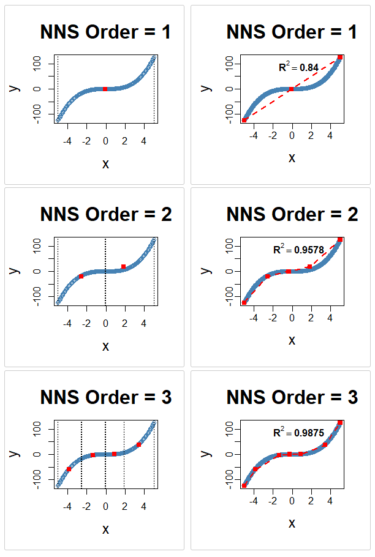

# Nonparametric Regression

Chapters 18 and 19 developed recursive mean-split estimation and its dynamic-bandwidth interpretation. Chapter 21 connected recursive partitions to clustering. This chapter brings those ideas together as a practical method for estimating a regression function, with particular attention to what the current software actually computes.

**Nonlinear Nonparametric Statistics (NNS)** uses benchmark-relative partition geometry and local statistical summaries to represent potentially nonlinear relationships without imposing a global regression equation. The abbreviation *NNS* throughout this chapter refers to that partial-moment-based framework and its R and Python implementations, not to an unrelated nearest-neighbor acronym. The phrase *nearest-neighbor search* below describes one operation performed by the multivariate estimator.

The crucial distinction is between two prediction paths:

- **Univariate regression.** Recursive predictor-space partitions supply regression points. With the ordinary numeric regression options and `smooth = FALSE`, `NNS.reg` joins the points by straight line segments; it is not simply a step-function cell mean.
- **Multivariate regression.** Per-predictor partitions are combined into occupied joint groups. Their predictor and response summaries form a **regression point matrix (RPM)**, and a distance-based neighbor rule predicts from its rows.

A third path first reduces a multivariate predictor matrix to a single synthetic index, then uses univariate regression on that index. These paths share a partition foundation but have different prediction operators, smoothness properties, and statistical requirements.

The distinction between *estimation architecture* and *software default* matters. Chapters 18 and 19 established a consistency-capable regime for arithmetic cell means, including certain response-selected rectangular partitions. They did not establish that any finite default `order`, `noise.reduction`, neighbor rule, or extrapolation policy automatically yields a universally consistent predictor. The present chapter makes those additional operators explicit.

---

## Regression as Conditional Expectation

Let the training sample be

\[
(X_1,Y_1),\ldots,(X_n,Y_n), \qquad X_i\in\mathbb R^d,\quad Y_i\in\mathbb R.
\]

For squared-error prediction, the population target is

\[
\boxed{f(x)=E[Y\mid X=x].}
\]

Equivalently, if \(Y=f(X)+\varepsilon\), the regression disturbance satisfies \(E[\varepsilon\mid X]=0\). The conditional mean minimizes expected squared prediction error among measurable functions, when the relevant moments exist:

\[
f\in\arg\min_g E[(Y-g(X))^2].
\]

This optimality property explains why the choice of *within-cell reducer* matters. Arithmetic averaging estimates a conditional mean. A median estimates a different central feature, and the NNS gravity summary combines several features. All may be useful; they are not interchangeable as estimators of \(E[Y\mid X=x]\). For example, if a numeric two-valued response has \(P(Y=1\mid X=x)=0.2\), its conditional mean is 0.2 but the continuous gravity center can tend to 0.05 (mean 0.2, zero median and mode, and zero quartile midpoint). To study that **numeric regression** case in the package rather than automatic classification of a 0/1 response, use `type = "REG"`.


A classical linear specification restricts the target to a family such as

\[
f_\beta(x)=\beta_0+\beta^\top x.
\]

Polynomial and additive models enlarge that family but still impose structural choices. Nonparametric estimation instead lets local information determine the fitted shape. This flexibility does not dispense with assumptions: nonparametric estimation still needs enough observations near each prediction location, and accurate extrapolation beyond the observed support generally cannot be guaranteed.

### What the absence of a parametric formula does and does not imply

A linear least-squares *point estimate* does not require normally distributed errors. Normality, constant variance, and related assumptions enter particular inference results, not the definition of least squares itself. Likewise, NNS does not automatically resolve endogeneity, unobserved confounding, dependence across observations, or uncertainty calibration simply by fitting a flexible function.

The NNS contribution is instead constructive: define informative, data-dependent predictor regions, summarize their observations, and assemble the summaries into a prediction rule.

---

## From Partial-Moment Partitions to Local Regression Points

Chapter 18 distinguished two ways to partition a pair \((X,Y)\):

1. **Joint partitioning** splits local \((X,Y)\) regions relative to centers on both axes. The four subregions express the directional co-partial-moment structure of the observed sample.
2. **Predictor-only partitioning** splits a local interval in \(X\) relative to a predictor center. The resulting cells can be assigned to a new predictor without observing its unknown response.

These two modes should not be conflated. Joint \((X,Y)\) quadrants are meaningful for representing the sample, but a new \(x\) does not reveal which response-defined quadrant it belongs to. For ordinary numeric-order regression, the current univariate `NNS.reg` route builds its regression points using `NNS.part(..., type = "XONLY", ...)`. The multivariate route likewise obtains predictor-space landmarks one coordinate at a time, although its automatic order may depend on responses.

Let \(A\) be an occupied predictor-space cell, and let

\[
I_A=\{i:X_i\in A\},\qquad N_A=|I_A|.
\]

Under `noise.reduction = "mean"`, its response summary is

\[
\bar Y_A=\frac1{N_A}\sum_{i\in I_A}Y_i.
\]

A univariate regression point is the pair

\[
(c_A,r_A)=(\bar X_A,\bar Y_A),\qquad
\bar X_A=\frac1{N_A}\sum_{i\in I_A}X_i.
\]

For \(d\) predictors, the analogous local predictor center is the vector \(\bar X_A\in\mathbb R^d\). The package default, however, is `noise.reduction = "off"`; that setting uses `NNS.gravity` to generate the chosen centers. Therefore the following mean formulas are exact descriptions of the arithmetic-mean configuration and theoretical building block, **not** a blanket description of the package default.

### A local mean is not yet a complete prediction rule

The simplest partition histogram reports

\[
\hat f_n^{\mathrm{cell}}(x)=\bar Y_{A_n(x)}.
\]

The actual `NNS.reg` predictor takes an additional step: it either interpolates ordered regression points or weights neighboring RPM rows. That step changes the observations contributing to a query, its effective bandwidth, and potentially its bias and variance. A theorem for the cell means must therefore be transported through the prediction operator rather than asserted for the entire regression routine without qualification.

---

## Univariate NNS Regression: A Piecewise-Linear Function

For one numeric predictor, `NNS.reg` constructs a set of distinct, ordered regression points

\[
(c_1,r_1),\ldots,(c_J,r_J),\qquad c_1<\cdots<c_J.
\]

The current routine also inserts anchors at the smallest and largest observed predictor locations, using the configured reducer for responses found at those boundary locations. Those anchors are worth distinguishing from interior cell means, especially when the boundary locations occur only once and their observed responses contain noise.

### Piecewise-constant cell estimator

A purely local mean estimator assigns \(\bar Y_A\) to every \(x\in A\). Its prediction changes at cell boundaries. This is the most direct histogram-regression object to which partition consistency theory applies.

### Piecewise-linear regression-point estimator

With `smooth = FALSE`, if \(x\in[c_j,c_{j+1}]\), the NNS regression-point predictor is

\[
\boxed{\hat f_n(x)=
\frac{c_{j+1}-x}{c_{j+1}-c_j}\,r_j+
\frac{x-c_j}{c_{j+1}-c_j}\,r_{j+1}.}
\]

The two coefficients are nonnegative and sum to one **inside** the segment. Thus the prediction is continuous across the distinct regression points and uses a local convex combination of their response coordinates. The resulting function is piecewise linear, not a local least-squares polynomial fitted separately inside each cell.

For \(x<c_1\) or \(x>c_J\), the current routine extends the first or last segment linearly. This is *extrapolation*, not interpolation: the coefficients need not stay between zero and one, and small differences between noisy endpoint observations can produce unstable slopes. The optional `smooth = TRUE` instead fits a smoothing spline through the regression points; it is a different prediction operator, with its smoothing parameter tied to an internal dependence measure.

### A reproducible illustration

The following R example demonstrates both predictor-only partitions and the corresponding `NNS.reg` fits for a noiseless cubic. Specifying the mean reducer makes the displayed regression points agree with the arithmetic formulas above.

```r
library(NNS)

x <- seq(-5, 5, by = 0.05)
y <- x^3

for (ord in 1:3) {
  NNS.part(
    x, y,
    type = "XONLY", order = ord, obs.req = 0,
    noise.reduction = "mean", Voronoi = TRUE
  )
  NNS.reg(
    x, y,
    type = "REG", order = ord,
    noise.reduction = "mean", ncores = 1,
    plot = TRUE, residual.plot = FALSE
  )
}
```

The corresponding Python API uses snake-case parameter names:

```python
import numpy as np
from nns import nns_part, nns_reg
from nns.plotting import plot_nns_part, plot_nns_reg

x = np.arange(-5.0, 5.01, 0.05)
y = x**3

for order in (1, 2, 3):
    part = nns_part(
        x, y, type="XONLY", order=order,
        obs_req=0, noise_reduction="mean"
    )
    plot_nns_part(part)
    fit = nns_reg(x, y, type="REG", order=order,
                  noise_reduction="mean")
    plot_nns_reg(fit)
```

<center>

</center>

*Figure note.* The image link retains the existing book asset. The R and Python code above describes how to regenerate the underlying illustration with the explicitly selected arithmetic-mean option; exact visual output can depend on plotting defaults and package version.

---

## Partition Clusters and the Meaning of the Fit

The clustering perspective of Chapter 21 is more than an analogy. Recursive splitting defines groups of observations according to local benchmark comparisons. Once those groups are formed, their response summaries supply regression representatives.

For the mean reducer, the chain is

\[
\text{predictor distribution}
\longrightarrow\text{recursive local cells}
\longrightarrow(c_A,\bar Y_A)
\longrightarrow\hat f_n(x).
\]

The same partition can therefore be viewed as a geometric clustering of the observed sample and as the basis of a regression approximation. The regression function adds a rule for connecting or combining the local representatives.

The interpretability is concrete. A fitted segment has endpoints given by observed local summaries, and its slope is

\[
\hat\beta_j=\frac{r_{j+1}-r_j}{c_{j+1}-c_j}.
\]

This is a slope of the fitted regression-point function. It is not necessarily the derivative of the population conditional mean. With a sufficiently refined and stable fit it can approximate that derivative, but derivative estimation is more demanding than consistency of function values: noisy differences are amplified when centers become very close.

### Distinguishing predictor adaptivity from curvature adaptivity

At a **fixed numeric order** with X-only mean splitting, the predictor boundaries are determined by the predictor values. Replacing a nearly flat response by a curved response leaves those boundaries unchanged. The *response coordinates* of the regression points change, and a response-dependent choice of order can change how far the recursion proceeds.

This distinction matters for claims of optimal bandwidth selection. NNS automatically constructs variable predictor-space widths; the current automatic order heuristic responds to empirical dependence, but it is not proved to select the risk-optimal local resolution for every smoothness class.

---

## Bias, Variance, and Three Scales of Localization

Chapter 19 showed that a cell's diameter functions as a stochastic bandwidth. In \(d\) dimensions a simple geometric definition is

\[
h_n^{\mathrm{cell}}(x)=\operatorname{diam}(A_n(x)).
\]

The smaller the cell, the more local the averaging. The larger its occupancy \(N_n(x)\), the more opportunities for independent observation noise to cancel. The two properties must be balanced, not maximized separately.

Under a locally smooth regression function and a regular predictor distribution, the familiar heuristic is

\[
\operatorname{MSE}(x)\ \approx\ C_1h(x)^{2\alpha}
+\frac{C_2}{n\,h(x)^d},
\]

where \(\alpha\) describes local smoothness. This formula illustrates the bias-variance tension; it is **not** an exact finite-sample risk formula for response-selected NNS cells.

### From cell bandwidth to prediction bandwidth

In univariate linear interpolation, two groups can contribute to one query. Its effective support is the union of the observations represented by the two regression points, rather than just the cell containing \(x\). Multivariate RPM regression adds another layer: the selected neighbor groups can reach farther than the query's immediate coordinatewise cell.

For the multivariate procedure, it is useful to distinguish:

- **Coordinate scale:** widths of the individual predictor intervals used to assign identifiers.
- **Joint-cell scale:** geometry and occupancy of the occupied intersections summarized by RPM rows.
- **Prediction reach:** distance from the query to all observations underlying the RPM rows receiving nonzero prediction weight.

These scales need not shrink together. Even when each coordinate interval is narrow, an RPM prediction can draw weight from a distant group if local occupied groups are sparse. A formal consistency claim must control the observations *actually contributing to the final prediction*, not just the widths of some marginal partitions.

---

## Conditional-Mean Consistency: What Follows from Data-Adaptive Partitions

The main mathematical result from Chapter 18 is stronger than the old objection that any response-selected partition invalidates a simple averaging argument.

**Proposition (response-adaptive rectangular cell means; restated).** Suppose \((X_i,Y_i)\) are i.i.d., predictor dimension \(d\) is fixed, \(|Y_i|\le B<\infty\), and the conditional mean \(f\) is continuous at \(x\). Let \(A_n(x)\) be any axis-aligned rectangular predictor-space cell containing \(x\), selected using the full training sample, including the observed responses. If

\[
\operatorname{diam}(A_n(x))\xrightarrow{P}0,
\qquad
\frac{N_n(x)}{\log(n+1)}\xrightarrow{P}\infty,
\]

then the arithmetic cell average satisfies

\[
\boxed{E[(\hat f_n^{\mathrm{cell}}(x)-f(x))^2]\longrightarrow0.}
\]

*Why selection on the responses is permitted.* Conditional on the observed predictor values, axis-aligned rectangles in fixed dimension generate at most polynomially many distinct sample-membership sets (at most \((n+1)^{2d}\)). A Hoeffding bound followed by a union bound controls the centered response average *uniformly over every rectangle* containing sufficiently many sample points. It therefore also controls a rectangle chosen after looking at the responses. Continuity and a shrinking cell control the approximation bias. Boundedness then upgrades convergence in probability to mean-square convergence. See Chapter 18 for the complete argument.

The proposition supplies a sufficient *pointwise* condition for a predictor-cell mean, not a universal theorem for `NNS.reg` defaults. Nobel (1996) gives a broader integrated consistency framework for data-dependent regression partitions with appropriate complexity and shrinking-cell conditions. The Lugosi--Nobel (1996) paper, often cited nearby, specifically concerns density estimation and classification rather than this regression statement.

### The interpolation step

For univariate NNS interpolation, an additional sufficient condition is that the two regression-point centers bracketing an interior query represent **local, well-occupied** predictor intervals. If their observed reaches from \(x\) tend to zero, their occupancies grow faster than \(\log n\), and their response coordinates are arithmetic means, each regression-point response converges to \(f(x)\). A convex interpolation of the two converges as well.

The standard endpoint anchors do not necessarily represent growing groups; they require special attention when the query approaches the support boundary. Linear extrapolation outside the training support also falls outside that convexity argument.

### A feasible, but nonautomatic, refinement schedule

Suppose a regular one-dimensional design permits sufficiently balanced mean-split recursion. If the depth grows on the order of \(O_n\asymp\alpha\log_2 n\), with \(0<\alpha<1\), then a suitable balance-and-contraction result can produce \(2^{O_n}\asymp n^\alpha\) cells, typical occupancy of order \(n^{1-\alpha}\), and shrinking widths. Under those extra geometric assumptions, the cell consistency requirements can coexist.

That is an illustrative **sequence of tuned models**, not the automatic depth rule currently used by `NNS.reg`. Its default depth is bounded even as the sample grows. A fixed small stopping occupancy can also prevent the cell counts from diverging in the way the theorem requires. Neither response-sensitive partition selection nor mean reduction alone proves the appropriate asymptotic refinement.

---

## Exact Fit, Noiseless Approximation, and Noisy Interpolation

Two limiting results from Vinod and Viole's clustering interpretation are useful, but they must be assigned their correct statistical meaning.

### Noiseless interpolation

Suppose \(Y_i=f(X_i)\) exactly, with distinct ordered predictor locations, and select `order = "max"` with the mean reducer. At observed predictor locations the fitted line can recover the observed responses. On a compact interval, if \(f\) is continuous and the maximum gap between sampled predictor points tends to zero, linear interpolation satisfies the uniform bound

\[
\sup_{x\ \mathrm{between\ sampled\ endpoints}}
|\hat f_n(x)-f(x)|\le\omega_f(\delta_n)\longrightarrow0,
\]

where \(\delta_n\) is the largest consecutive predictor gap and \(\omega_f\) is the modulus of continuity. This makes the noiseless limiting-fit claim precise. It is a positive uniform approximation result, not just a visual observation about high-order plots.

### Why maximum-order interpolation need not denoise

Now let \(Y_i=\varepsilon_i\), with independent mean-zero errors of variance \(\sigma^2>0\), and let \(X_i=i/(n+1)\), with even \(n\). The true regression function is \(f(x)=0\). At \(x=1/2\), exactly between two consecutive observations, maximum-order linear interpolation gives

\[
\hat f_n(1/2)=\frac{\varepsilon_{n/2}+\varepsilon_{n/2+1}}2,
\qquad
E[\hat f_n(1/2)^2]=\frac{\sigma^2}{2}.
\]

The error does not vanish with \(n\). The method interpolates the noisy training observations but does not, in this configuration, consistently estimate their conditional mean.

### Why a fixed order cannot approximate every curve

The other extreme has a bias problem. For numeric univariate `NNS.reg`, the dependence-driven default order is capped at 10. Its finite set of mean-split regression points, plus boundary anchors, gives a uniform cap on the number of straight segments. A fixed number of linear segments cannot approximate every curved \(f\) with vanishing integrated squared error. Chapter 18 derives an explicit positive approximation floor for \(f(x)=x^2\).

Both limits teach the same lesson: consistent noisy-data nonparametric estimation generally requires *increasing local resolution while retaining increasing local sample support*.

---

## Multivariate Regression: The Regression Point Matrix

For \(X_i=(X_i^{(1)},\ldots,X_i^{(d)})\), a single linearly ordered sequence of regression points no longer exists. The multivariate NNS implementation therefore uses a different construction.

### Step 1: construct predictor landmarks by coordinate

For each predictor \(j\), the routine constructs a set of boundaries or landmarks from the numeric-order predictor-only regression-point procedure applied to \((X^{(j)},Y)\). If `order = NULL`, the selected depth may depend on the association of that particular predictor with the response. For `order = "max"`, or for a coordinate with exactly two distinct observed values, the routine uses its distinct observed support locations directly.

A technical distinction matters here: **the implementation uses regression-point locations as interval boundaries for the multivariate grouping**. These boundaries need not be identical to the terminal cells that appeared during the earlier recursive splitting operation. Predictors with duplicate columns can share the same computed boundary sequence.

### Step 2: assign joint identifiers

Let \(b_j(X_i^{(j)})\) denote the interval or support identifier assigned to observation \(i\) on predictor \(j\). Its joint identifier is the tuple

\[
G_i=\bigl(b_1(X_i^{(1)}),\ldots,b_d(X_i^{(d)})\bigr).
\]

Observations with the same tuple form one *occupied joint group*. Each group is an intersection of predictor-coordinate regions. If coordinate \(j\) has \(K_j\) possible identifiers, the number \(M\) of occupied joint groups obeys

\[
\boxed{M\le\min\left(n,\prod_{j=1}^dK_j\right).}
\]

The algorithm retains occupied combinations; it does not need to allocate a dense Cartesian-product array of all possible combinations. Nevertheless, in a sparse design it is possible that \(M=n\), so compression is not guaranteed.

### Step 3: assemble the RPM

Let \(I_r=\{i:G_i=r\}\) and \(m_r=|I_r|\) for occupied group \(r\). With `noise.reduction = "mean"`, the RPM row consists of

\[
z_r=\frac1{m_r}\sum_{i\in I_r}X_i\in\mathbb R^d,
\qquad
\nu_r=\frac1{m_r}\sum_{i\in I_r}Y_i.
\]

The matrix is therefore

\[
\mathrm{RPM}=
\begin{bmatrix}
z_1^\top&\nu_1\\
\vdots&\vdots\\
z_M^\top&\nu_M
\end{bmatrix}.
\]

In the returned R object, the response-summary column is named `y.hat`. Under the package default `noise.reduction = "off"`, RPM coordinates and responses instead use the selected gravity-based center. An RPM row is always a **group summary**; it is only a *conditional sample mean* when the mean reducer is requested.

### Why RPM compression can matter

When \(m_r>1\), replacing those observations by one group center can reduce the number of search candidates and, under appropriate sampling assumptions, reduce response noise through averaging. When \(m_r=1\), the mean RPM row is the original observation; compression and within-cell averaging provide no benefit for that row. This is why RPM occupancy, not only its row count, is a key diagnostic in high-dimensional NNS regression.

---

## From the RPM to an Actual Prediction

The complete multivariate prediction mechanism has two steps: find nearby RPM predictor centers, then combine their stored response summaries. It is not a direct lookup of the query's terminal cell mean.

### Distance to an RPM row

For continuous predictor coordinates, the default `dist = NULL` selects the NNS distance. Let \(R_j\) be the observed range of predictor \(j\), and ignore constant coordinates. Define

\[
\Delta_{rj}(x)=\frac{z_{rj}-x_j}{R_j}.
\]

The default distance is

\[
\boxed{d_{\mathrm{NNS}}(z_r,x)=
\sum_{j:R_j>0}\bigl(|\Delta_{rj}(x)|+\Delta_{rj}(x)^2\bigr).}
\]

`dist = "L1"` instead sums the absolute normalized differences; `dist = "L2"` takes the square root of their squared sum. `dist = "FACTOR"` uses the proportion of unequal encoded categorical coordinates. These choices change the ranking of nearby RPM rows and therefore the effective prediction neighborhood.

### Neighbors and ensemble weights

Let \(\mathcal N_k(x)\) be the \(k\) closest RPM rows, with deterministic tie ordering where applicable. For \(k\ge2\), the implementation constructs and normalizes an ensemble of nonnegative rank- and distance-based weight vectors: uniform rank, Student-\(t\), inverse distance, exponential rank, lognormal rank, inverse-square rank, normal distance, and radial-basis-function distance weights.

Writing the final normalized weights as \(w_r(x)\), the continuous-response prediction is

\[
\boxed{\hat f_n^{\mathrm{RPM}}(x)
=\sum_{r\in\mathcal N_k(x)}w_r(x)\nu_r,
\qquad w_r(x)\ge0,\quad\sum_{r\in\mathcal N_k(x)}w_r(x)=1.}
\]

This equation is exact for the ordinary multiple-neighbor, numeric-response weighting path. Its values are weighted combinations of RPM response centers, not coefficients of a global multivariate polynomial or a linearly interpolated surface.

**One-neighbor tie exception.** When `n.best = 1`, the current R implementation identifies **all exact nearest-distance ties**. For numeric regression, it applies `gravity()` to their RPM response summaries rather than taking a uniformly weighted arithmetic mean. With a unique nearest row the returned value is simply that row's response summary. Consequently, the boxed weighted-mean equation does *not* describe a nontrivial exact tie under `n.best = 1`, even if the RPM was built using `noise.reduction = "mean"`. This also means a consistency argument for arbitrary multivariate settings must treat that tie branch separately.

### A geometric difference from local linear interpolation

There is no natural total ordering of RPM rows in \(\mathbb R^d\). As \(x\) moves, its set of nearest RPM rows can change. The prediction need not be differentiable or even continuous across such transitions. It is therefore inaccurate to describe every multivariate NNS fit as a *smooth regression surface*. The output is a distance-weighted **local regression-point estimator** whose regularity depends on the neighbor and weighting rule.

---

## Adaptive Partition Depth and Neighbor Count

NNS offers two distinct response-sensitive forms of resolution selection: one when generating predictor landmarks and another when choosing the number of RPM neighbors.

### Automatic order is a bounded heuristic

For a numerical predictor \(j\), the current univariate order helper combines a **local NNS dependence score** with a reflected-response copula summary. Let \(D_j\in[0,1]\) denote the resulting combined finite-sample score. The ordinary default order is

\[
O_j=\max\{1,\lfloor10D_j+0.5\rfloor\},
\]

with an additional halving-and-flooring adjustment when fewer than 100 observations are available. The order is therefore **at most 10** regardless of sample size. The local score used internally is not simply the public `NNS.dep` output, which can have a different multilevel definition. When a numeric order is supplied explicitly, this automatic choice is bypassed.

This is a useful finite-sample complexity heuristic: a relatively weak relationship may receive fewer regression points, while a stronger relationship may receive more. It is not an estimator of the asymptotically optimal local Hölder bandwidth, and the cap means it is not itself a growing-order consistency schedule.

The separate `NNS.part` interface has its own default depth and stopping rules. It should not be used to infer the default depth of `NNS.reg`.

### Automatic `n.best` is a separate rule

For a multivariate numeric fit, let \(D_{\mathrm{multi}}\) be the mean of the NNS copula summaries computed on \((X,Y)\) and \((X,-Y)\). With \(M\) RPM rows, the ordinary automatic neighbor count is

\[
\boxed{k=
\min\left\{M,\max\left(1,
\left\lfloor(1-D_{\mathrm{multi}})\sqrt n\right\rfloor
\right)\right\}.}
\]

A higher dependence score tends to use fewer RPM rows; a lower score tends to aggregate over more rows. However, `order = "max"` and the purely categorical exact-cell route select \(k=1\) by default unless the caller supplies `n.best`. The user may also supply an integer count or `n.best = "all"`.

Depth and neighbor count are therefore different controls. Refining the RPM creates more candidate local representatives; increasing \(k\) combines more of those representatives in the final prediction. The resulting effective resolution cannot be characterized by either parameter alone.

### `rhs.partitions` is not a depth report

The returned `rhs.partitions` object contains **partition-point values or boundaries for each predictor**, with shorter columns padded for rectangular storage. It is not an array of realized numerical recursion depths. The returned `n.best` records the neighbor count used for the multivariate fit; `RPM` contains its group summaries. A requested order, the resulting boundary count, and the number of occupied RPM rows are three different quantities.

---

## A Multivariate Consistency Principle for RPM Mean Prediction

The cell-mean theorem from Chapter 18 can be carried through the multivariate RPM weights, but only under conditions on the **joint occupied groups actually receiving weight**.

**Proposition (sufficient condition for mean-based RPM consistency).** Suppose \((X_i,Y_i)\) are i.i.d., \(X_i\in\mathbb R^d\) for fixed \(d\), \(|Y_i|\le B\), and \(f(x)=E[Y\mid X=x]\) is continuous at an interior query \(x\). Suppose an RPM prediction is a convex combination of arithmetic response means from occupied axis-aligned rectangular groups. The groups and weights may be chosen using the entire training sample. Assume that, with probability tending to one:

1. Every selected group carrying positive weight has observed predictor points within distance \(\rho_n\) of \(x\), where \(\rho_n\xrightarrow{P}0\).
2. Every selected group carrying positive weight has occupancy at least \(m_n\), where \(m_n/\log(n+1)\to\infty\) for a deterministic sequence \(m_n\).
3. The weights are nonnegative and sum to one.

Then

\[
E[(\hat f_n^{\mathrm{RPM}}(x)-f(x))^2]\longrightarrow0.
\]

**Proof.** For every occupied rectangular group \(A_r\), decompose its arithmetic response mean into the mean of \(f(X_i)\) plus the mean of the centered errors \(Y_i-f(X_i)\). On the stated localization event, the first term differs from \(f(x)\) by at most the continuity modulus \(\omega_{f,x}(\rho_n)\). Conditional on predictor locations, the uniform rectangular-subset concentration argument from Chapter 18 bounds all centered error means over all groups containing at least \(m_n\) observations, whether the groups were selected with responses or not. A convex combination of these errors is bounded by their maximum absolute value; the same holds for the localization error. Thus the prediction converges to \(f(x)\) in probability. It is bounded because it is a convex combination of bounded response means, yielding mean-square convergence. \(\square\)

This is a **sufficient theorem for the specified mean-weighted path**, not a claim that the current `order = NULL` and `n.best = NULL` choices satisfy its conditions. It also does not cover an exact nearest-distance tie that invokes the distinct gravity reducer, non-mean RPM centers, arbitrary feature projection, or unrestricted extrapolation without further analysis.

### Observation-level weights and effective sample size

The RPM architecture has an additional interpretation when the selected groups are disjoint and the response reducer is arithmetic. If group \(r\) contains \(m_r\) observations, then

\[
\hat f_n^{\mathrm{RPM}}(x)
=\sum_{r}w_r(x)\frac1{m_r}\sum_{i\in I_r}Y_i
=\sum_{i=1}^n a_i(x)Y_i,
\qquad a_i(x)=\frac{w_{G_i}(x)}{m_{G_i}}
\]

for observations in selected groups, and \(a_i(x)=0\) otherwise. The total observation weights sum to one. The usual dispersion-based effective sample size is therefore

\[
\boxed{n_{\mathrm{eff}}(x)
=\frac1{\sum_i a_i(x)^2}
=\left(\sum_{r\in\mathcal N_k(x)}\frac{w_r(x)^2}{m_r}\right)^{-1}.}
\]

Under an X-determined partition with suitable conditionally independent, bounded-variance errors, this quantity gives an ordinary conditional noise-variance bound. When the selected cells or weights depend on the **same observed responses**, the naive conditional-variance calculation is not automatically valid; the response-selection-aware uniform-concentration argument is the rigorous replacement. Nonetheless the effective-size identity gives a useful description of how RPM occupancy and neighbor weights interact.

---

## Optional Dimension Reduction: The Synthetic Predictor

The package offers a separate multivariate route selected by `dim.red.method`. Rather than preserving the whole RPM predictor geometry, it constructs a single synthetic predictor and applies the univariate NNS procedure to that index.

Rescale each numeric predictor using its training minimum and maximum, writing the result as \(\tilde X^{(j)}\). Constant coordinates receive the implementation's fixed neutral value. Let \(a_j\) be the selected signed coefficient and let \(q=\#\{j:a_j\ne0\}\). The index is

\[
\boxed{X^*=\frac{\sum_{j=1}^d a_j\tilde X^{(j)}}{q}.}
\]

The denominator is the number of nonzero coefficients, **not** the sum of coefficient magnitudes. Because coefficients can be negative, the synthetic index is not necessarily restricted to \([0,1]\), even though its constituent numerical predictors have been normalized.

### Choosing coefficients

Supported strategies include:

- `dim.red.method = "equal"`: unit coefficients for all included columns.
- `dim.red.method = "cor"`: **Spearman rank-correlation** coefficients, including their signs.
- `dim.red.method = "NNS.dep"`: directional nonlinear dependence coefficients.
- `dim.red.method = "NNS.caus"`: directional association / lag-sensitive coefficients, with the `tau` convention where relevant; these are not automatically identified causal effects.
- `dim.red.method = "all"`: an average of the implemented causation, dependence, rank-correlation, and equal-weight components.
- A numeric vector of supplied coefficients, optionally named to match the encoded predictor columns.

The `threshold` argument sets small absolute coefficients to zero; if thresholding would eliminate every predictor, the implementation restores an available coefficient vector so an index can still be constructed. Factor predictors may first be encoded into numeric indicator columns (`factor.2.dummy = TRUE` by default).

After projection, the actual target of the resulting univariate fit is

\[
g(t)=E[Y\mid X^*=t].
\]

It equals the original \(f(x)=E[Y\mid X=x]\) only if the index retains all regression-relevant information, in the sense that \(E[Y\mid X]=g(X^*)\) almost surely. Projection can improve parsimony and variance but can also discard interactions or distinguishable predictor combinations. Synthetic-index regression should therefore be evaluated against the full multivariate path rather than presumed to dominate it.

### Two different kinds of dimension handling

**Full RPM regression** retains the encoded predictor coordinates and compresses *occupied combinations* only when multiple observations fall in a joint group. **Synthetic-index regression** reduces the coordinate dimension itself to one. The first can retain interactions not expressible through a single index; the second creates a naturally ordered, piecewise-linear prediction problem but introduces possible projection bias.

---

## Interpretation, Diagnostics, and Derivatives

The pieces of the estimator are observable and can be inspected, which is a major advantage when evaluating a fitted model.

### Fit summaries and their meanings

- `regression.points` lists ordered centers in univariate regression; its boundary anchors may be individual observations.
- `rhs.partitions` gives multivariate coordinate landmarks / boundaries, **not** depth estimates.
- `RPM` lists occupied joint-group centers and response summaries.
- `n.best` identifies the chosen multivariate neighbor count.
- `Point.est` gives predictions **only when** the caller supplies prediction locations through `point.est`.
- `Fitted.xy` holds fitted training values and related diagnostics when full output is requested.

For numeric regression, reported `R2` is the squared correlation of observed and fitted responses (the Racine--Hastie convention), not necessarily \(1-\mathrm{SSE}/\mathrm{SST}\). It measures association and can be high even when estimates are systematically displaced or incorrectly scaled. Held-out mean squared error, mean absolute error, and calibration against the intended target should accompany it.

### Univariate slopes and derivatives

For consecutive regression points, the fitted segment slope

\[
\hat\beta_j=(r_{j+1}-r_j)/(c_{j+1}-c_j)
\]

is reported through the univariate derivative output and is related to `dy.dx`. `dy.d_` provides multivariate finite-step partial-derivative estimates of a fitted NNS prediction surface. These are **estimates of the fitted function's local change**, not exact population derivatives by construction. Differentiation generally magnifies errors, and nearest-neighbor switches can make the multivariate RPM surface nonsmooth.

### Prediction intervals

The `confidence.interval` option constructs intervals from in-sample residual quantiles under the package's implemented convention. These descriptive intervals do not automatically have calibrated out-of-sample conditional or unconditional coverage. Coverage claims would require separate assumptions or validation, especially for response-adaptive partitions.

---

## Worked Example: Full Multivariate Mean-Reducer Regression

The following example is deliberately designed with **mean-zero noise**. The known signal is then the true conditional mean, so its evaluation does not conflate structural recovery with a nonzero error mean.

```r
library(NNS)
set.seed(22)

n <- 320L
X <- data.frame(
  x1 = runif(n, -2, 2),
  x2 = runif(n, -2, 2)
)
signal <- sin(X$x1) + 0.6 * X$x2^2
y <- signal + rnorm(n, sd = 0.2)

train <- sample(seq_len(n), size = 250L)
test <- setdiff(seq_len(n), train)

fit <- NNS.reg(
  X[train, , drop = FALSE], y[train],
  point.est = X[test, , drop = FALSE],
  noise.reduction = "mean",
  order = NULL,
  n.best = NULL,
  plot = FALSE, residual.plot = FALSE,
  ncores = 1
)

head(fit$RPM)              # Occupied-group predictor and response centers
fit$n.best                 # Chosen number of RPM neighbors
fit$rhs.partitions         # Predictor boundaries, not the depth vector
head(fit$Point.est)        # Held-out predictions (point.est was supplied)
mean((fit$Point.est - signal[test])^2)  # Error relative to true E[Y | X]
```

The analogous Python call uses the public NNS-Python interface, which is intended to parallel the R algorithm:

```python
import numpy as np
from nns import nns_reg

rng = np.random.default_rng(22)
n = 320
X = rng.uniform(-2.0, 2.0, size=(n, 2))
signal = np.sin(X[:, 0]) + 0.6 * X[:, 1] ** 2
y = signal + rng.normal(0.0, 0.2, size=n)

perm = rng.permutation(n)
train, test = perm[:250], perm[250:]
fit = nns_reg(
    X[train], y[train],
    point_est=X[test],
    noise_reduction="mean",
    order=None,
    n_best=None,
)
pred = np.asarray(fit["Point.est"], dtype=float)
print(fit["RPM"])
print(fit["n.best"])
print(np.mean((pred - signal[test]) ** 2))
```

The two snippets implement **analogous experiments, not identical random samples**: R and NumPy use different random-number generators. Numerical equality across languages requires the same inputs and parity testing, rather than matching the seeds alone.

### A comparison with the synthetic-index path

```r
fit.index <- NNS.reg(
  X[train, , drop = FALSE], y[train],
  point.est = X[test, , drop = FALSE],
  dim.red.method = "cor",
  noise.reduction = "mean",
  plot = FALSE, residual.plot = FALSE,
  ncores = 1
)

mean((fit.index$Point.est - signal[test])^2)
fit.index$equation     # Coefficients and nonzero-coefficient denominator
```

This comparison measures the tradeoff between retaining the full predictor geometry and compressing it into one scalar. Neither approach is guaranteed to be better on every data-generating process.

---

## Relationship to Classical Nonparametric Estimators

### Linear, polynomial, and additive regression

Global linear or polynomial models constrain the functional form before observing local structure. Generalized additive models relax the shapes of marginal effects but usually rely on some additive-separability structure. NNS uses its partial-moment partitions to generate locally varying representatives. Whether that flexibility improves risk depends on the data and tuning.

### Regression trees

Both tree estimators and NNS define predictor regions recursively. CART typically chooses candidate splits by an impurity or loss criterion and often prunes the resulting tree. NNS uses local benchmark-relative split centers and separate depth / occupancy controls. Neither method receives a universal consistency guarantee simply from recursive partitioning.

### Kernels and local polynomials

Classical kernel regression uses explicit weights controlled by a bandwidth; more general adaptive-kernel and nearest-neighbor-bandwidth methods already permit location-varying scales. NNS is therefore **not the only adaptive-bandwidth method**. Its distinctive mechanism is the generation of local scales from partial-moment partition geometry, followed by regression-point interpolation or RPM neighborhood aggregation.

### Ordinary k-nearest-neighbor regression

Ordinary kNN searches raw predictor rows and averages their observed responses. Multivariate NNS searches *occupied-group representatives*. This can reduce the candidate count and smooth the response before distance weighting when groups contain multiple observations. With singleton groups, however, its candidate rows may coincide with the raw sample, and its statistical limitations remain similar. In addition, the native NNS distance and weight ensemble differ from ordinary equal-weight kNN.

### Structural comparison with ordinary kNN

| Feature | Conventional raw-data kNN regression | Full multivariate NNS regression |
|---|---|---|
| Candidate points | All \(n\) training predictor rows | \(M\) occupied-cell RPM summaries, \(M\le n\) |
| Stored response | Individual \(Y_i\) | A reducer of responses within each occupied group |
| Smoothing before search | None for ordinary raw kNN | Within-group averaging only when groups have multiple observations and the mean reducer is selected |
| Neighbor rule | Usually a chosen \(k\), frequently uniform weights | A configurable \(k\) with a dependence-based default and an ensemble of weights |
| Predictor metric | User-selected distance | Range-normalized NNS, L1, L2, or encoded-factor distance |
| High-dimensional limitation | Local neighbors become distant | Occupied intersections can be sparse; \(M\) can equal \(n\) |

### The curse of dimensionality

The RPM representation does not make sparse joint neighborhoods disappear. In \(d\) dimensions, the number of potential coordinate combinations grows multiplicatively, and the effective predictor distance to a well-supported group can increase quickly with \(d\). The synthetic-index option explicitly trades dimension for a stronger representation assumption. Neither strategy is a general dimension-free estimator.

---

## Research Context and What the Earlier NNS Papers Establish

Vinod and Viole (2018), *Nonparametric Regression Using Clusters*, developed the historical NNS regression-point and line-segment interpretation, illustrated exact high-order recovery of sampled noiseless functions, and compared finite-sample fits and partial-derivative estimates with kernel methods. Its interpolation property is genuine, but **interpolating observed noisy responses is not the same as consistently estimating their conditional mean**.

Viole's *Partitional Estimation Using Partial Moments* (posted in 2020 and revised in 2021) placed iterated-mean partitions alongside other partition-based estimation techniques and presented multivariate simulation comparisons. Those comparisons are useful empirical evidence for the historical workflows, not proofs that today's automatic `NNS.reg` settings achieve an asymptotic convergence rate. In that study, a simulated response includes an uncentered `runif(n)` term but MSE is reported against the unshifted structural function; the resulting benchmark is not exactly the conditional mean. Keeping the estimand explicit avoids this ambiguity.

Stone (1977), Györfi et al. (2002), and especially Nobel (1996) supply the general regression-consistency context. Nobel directly addresses **data-dependent regression partitions**, including partitions chosen using responses. This supports the mean-reducer NNS architecture *under the stated regularity, complexity, and localization conditions*, while leaving the full implementation-specific tuning and prediction analysis to be checked.

The next theoretical question is stronger than simple feasibility of consistency: can a specified sample-size-dependent NNS order and neighbor policy be shown to adapt to unknown local smoothness or attain a useful oracle risk bound? The current dependence heuristic alone does not establish such an optimality claim.

---

## Practical Perspective on NNS Regression

NNS regression is best understood as a family of related, transparent estimators rather than one universal smoothing rule.

- **Partial-moment geometry** supplies local benchmark-relative partitions.
- **Local reducers** determine what each group represents; the arithmetic mean targets conditional expectation.
- **Univariate interpolation** joins ordered regression points into a piecewise-linear curve, with explicit endpoint extrapolation behavior.
- **Multivariate RPM prediction** combines occupied joint-group summaries using neighbor distances and weights, subject to an exact-tie gravity exception when one neighbor is requested.
- **Automatic dependence heuristics** control finite-sample resolution and smoothing but do not alone establish a universal asymptotic guarantee.
- **Optional synthetic-index reduction** exchanges some multivariate structure for one-dimensional parsimony.

A practical evaluation should report more than the requested `order`: the realized predictor boundaries, occupied RPM count, group occupancies where available, neighbor count, distance setting, reducer, and held-out prediction error all matter to the actual effective bandwidth.

---

## Summary

This chapter described nonparametric regression in **Nonlinear Nonparametric Statistics (NNS)** as a two-stage process: construct local predictor-space representatives using recursive partial-moment partitions, and convert those representatives into predictions.

In one dimension, `NNS.reg` sorts regression points and interpolates their response coordinates through connected line segments, with an optional smoothing spline and explicitly linear extrapolation at the extremes. In several dimensions, it constructs an RPM from occupied intersections of coordinatewise partitions and predicts by distance-based aggregation over selected RPM rows. This is a local, response-informed estimator, not a global linear equation; importantly, it is **not identical to a cell histogram mean**.

The arithmetic-mean form supports an explicit consistency theory when joint cells become local, group occupancies grow sufficiently, and the final prediction weights concentrate on appropriate groups. Response-selected partition rules can satisfy that theory because rectangular cell families have controlled statistical complexity. The implementation's bounded automatic order, reducer choice, endpoint anchors, special tie handling, and multivariate neighbor selection nevertheless require separate verification before asserting consistency of a particular configuration.

NNS avoids prescribing a fixed numerical bandwidth and creates location-dependent scales through recursive partition geometry. This is a distinctive contribution relative to conventional *fixed-bandwidth* smoothing, though it does not eliminate bandwidth selection as a statistical problem or establish superiority over all adaptive kernel and neighbor methods.

The next chapter turns from numeric responses to **classification**, where conditional class probabilities and discrete decisions introduce additional prediction and calibration questions.

> **Further reading and examples.** See the NNS repository's [regression examples](https://github.com/OVVO-Financial/NNS/blob/NNS-Beta-Version/examples/README.md#2-regression). For the package's implemented arguments and return values, consult the current `R/Regression.R` and `R/Multivariate_Regression.R` sources; for Python, consult `src/nns/_public_reg.py` and `src/nns/_reg_engine.py` in NNS-Python.

---

## References

- Györfi, L., Kohler, M., Krzyżak, A., & Walk, H. (2002). *A Distribution-Free Theory of Nonparametric Regression*. Springer.

- Lugosi, G., & Nobel, A. (1996). Consistency of data-driven histogram methods for density estimation and classification. *Annals of Statistics*, 24(2), 687-706. https://doi.org/10.1214/aos/1032894460

- Nobel, A. (1996). Histogram regression estimation using data-dependent partitions. *Annals of Statistics*, 24(3), 1084-1105. https://doi.org/10.1214/aos/1032526958

- Stone, C. J. (1977). Consistent nonparametric regression. *Annals of Statistics*, 5(4), 595-620.

- Vinod, H. D., & Viole, F. (2018). Nonparametric regression using clusters. *Computational Economics*, 52(4), 1317-1334. https://doi.org/10.1007/s10614-017-9713-5 (published online in 2017).

- Vinod, H. D., & Viole, F. (2018). Clustering and curve fitting by line segments. *Preprints*, 2018010090. https://doi.org/10.20944/preprints201801.0090.v1

- Viole, F. (2020; revised 2021). Partitional estimation using partial moments. *SSRN*. https://doi.org/10.2139/ssrn.3592491

- Viole, F., & Nawrocki, D. (2013). *Nonlinear Nonparametric Statistics: Using Partial Moments*. CreateSpace.
